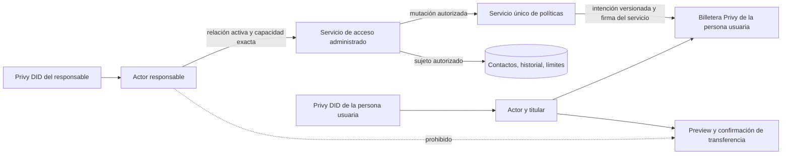

# TDD: onboarding de persona usuaria y responsable

Estado: **diseño de sistema aprobado; diseño de programa revisión 1 propuesto**. PRD rector: `03-prd.md`, revisión 3, aprobado por Ramiro el 2026-10-10 y registrado en `1edc62c`.

## Diseño de sistema, revisión 1

### Identidades y propiedad

La identidad autenticada (`actorUserId`) proviene exclusivamente del token Privy verificado y su DID. La persona cuya billetera o datos se consultan es el `subjectUserId`. La persona usuaria mantiene su DID, `users.id`, billetera, firmantes, contactos e historial actuales. El responsable tiene otro DID y `users.id`; puede tener además su propia billetera, pero el rol de responsable no la requiere. La elección visual de perfil nunca sustituye la identidad autenticada.

Un usuario puede tener ambos roles. Una relación activa entre `guardian_user_id` y `beneficiary_user_id` otorga sólo estas capacidades sobre el sujeto: leer contactos, historial y límites; crear/editar/quitar contactos; fijar o quitar el límite de transferencias ordinarias. La relación no da capacidad de preparar, confirmar, firmar, enviar o reintentar transferencias; tampoco de administrar firmantes o autorizaciones delegadas. Varias relaciones por lado son válidas.



### Invitación y vinculación

El responsable autenticado crea una invitación dirigida a un correo normalizado. La invitación tiene identidad, versión, emisor, correo, alcance legible, vencimiento y estado `pending`; crearla no busca ni revela la existencia de una cuenta. La respuesta pública de alta evita enumerar correos. Se limita la tasa de invitaciones y se permite reenviar sin duplicar vínculos activos.

El token de acceso de Privy prueba el DID, **no un correo**. Para mostrar/aceptar invitaciones, un servicio restringido consulta los métodos de correo vinculados y verificados del DID mediante una API de Privy de confianza; sólo devuelve invitaciones que coinciden con esos correos, sin ofrecer búsqueda arbitraria por correo. Si la persona ingresó por teléfono sin verificar el correo invitado, Nana le pide verificar ese correo; no vincula por un texto del navegador. La aceptación enlaza IDs de usuario, no correos, y queda registrada con ambas identidades. Si el correo cambia después, el vínculo no cambia de titular automáticamente. Las invitaciones vencen a los siete días; aceptar, rechazar, revocar y reenviar son idempotentes y versionados.

Estados: `pending → accepted_pending_policy_authorization → active`, o `pending → declined/expired`; ambos estados aceptados pueden pasar a `revoked`. La aceptación y la autorización de administración de políticas se presentan como un flujo único a la persona usuaria. Si la autorización remota o la prueba de propiedad falla, el vínculo queda en `accepted_pending_policy_authorization`: el responsable puede leer los datos autorizados, pero ve que la gestión aún no está habilitada y no puede escribir políticas. Una reanudación desde la sesión de la persona usuaria completa la autorización. La aprobación de la invitación no se interpreta como una firma de transferencia.

La invitación dice en lenguaje claro que el responsable podrá agregar destinos y quitar por completo el límite de monto, sin una aprobación posterior por cada cambio. Así el consentimiento inicial cubre exactamente el alcance solicitado. Para billeteras ya enroladas bajo la política de 0,01 SOL, la ampliación no se deduce de la política antigua: se exige consentimiento nuevo del titular para el alcance amplio y un readback firmado/verificado antes de activar la administración. Si Privy no permite expresar o comprobar este consentimiento de una sola vez, no se activa la ampliación y se vuelve a decidir el producto; nunca se ensancha el firmante silenciosamente.

### Bandeja, inicio y voz

La tabla de invitaciones es la fuente de verdad. La bandeja existente recibe un tipo de notificación de vínculo con sólo el ID y datos de presentación seguros; marcarla leída no modifica la invitación. Antes del saludo y saldo habituales, el arranque consulta invitaciones pendientes. Las muestra en una tarjeta persistida y presenta una a la vez, en orden. Si hay voz, el backend obtiene esa invitación canónica y Nani pronuncia el nombre/correo del responsable y el alcance. El modelo no inventa quién invita ni qué permisos pide.

La voz usa una ventana de decisión de tipo `invitation`, excluyente con `transfer` y `contact`, unida a invitación/version, usuario, conversación y participante autenticado. Sólo cuenta una transcripción final afirmativa o negativa posterior a la presentación audible; se consume una vez mediante compare-and-set del estado persistido. Una respuesta de una ventana no sirve en otra. Si no se puede demostrar la presentación o se interrumpe, la voz no acepta la invitación y la tarjeta permite decidir.

Con el agente de voz actual, un `generateReply` puede parafrasear el texto. El diseño propone una frase redactada por el servidor y reproducida con TTS, esperando el fin de reproducción antes de abrir la ventana. LiveKit documenta `AgentSession.say()` y `SpeechHandle.waitForPlayout()` para esto, pero `say()` requiere un plugin TTS cuando se usa un modelo realtime. El programa debe validar la versión instalada y probar el audio real. No se activa una ventana basándose sólo en que el modelo recibió una instrucción. Referencia: https://docs.livekit.io/agents/multimodality/audio/.

### Autorización de datos y políticas

Las rutas actuales sin sujeto explícito siguen siendo de la persona autenticada. El responsable utiliza un espacio de API separado con `subjectUserId` explícito, por ejemplo `/v1/managed-people/:subjectId/...`; ese parámetro es una solicitud, nunca autoridad. Una capa de acceso administrado comprueba `actorUserId`, relación activa, versión y capacidad exacta en cada solicitud, dentro de la misma transacción que lee o muta los datos. La revocación se serializa con esas operaciones. No se agrega una política RLS general que permita a un responsable ejecutar cualquier consulta de la persona usuaria.

Después de la comprobación, repositorios estrechos ejecutan la operación en el ámbito RLS del titular. No se expone una transacción arbitraria con `app.user_id` cambiado a los controladores; el servicio de acceso administrado sólo ofrece métodos para contactos, historial y límites. Las rutas de conversación, room token, billetera, grants y firma no aceptan un sujeto ajeno. Si Nani atiende al responsable, su catálogo de herramientas se construye para ese rol y omite transferencias y cambios de firmante. El backend rechaza también una invocación manual de esos endpoints, aunque la UI la oculte.

Crear/editar/quitar contactos reutiliza el único servicio de política y su compositor, con `actorUserId` para auditoría y `subjectUserId` como propietario de la billetera. Los cambios de límites pasan por el mismo escritor y la misma cola versionada; no crean un segundo PATCH de Privy. En este diseño el límite editable es el monto **por transferencia ordinaria**: el producto aún no tiene un límite acumulado Solana activo, y las reglas de grants son otra autorización. El límite ordinario es un valor tipado: `capped(maxLamports)` o `unlimited`. El segundo omite sólo la condición de monto de la regla ordinaria; mantiene destinatarios permitidos, firmante canónico, políticas de grants y cualquier otra restricción que Privy tenga. La UI muestra “Sin límite por transferencia” y el antes/después antes de aplicar. El valor predeterminado de billeteras existentes sigue siendo 0,01 SOL hasta una mutación autorizada.

El commit local de una acción del responsable guarda autor, sujeto, relación/version, cambio e intención de política en una transacción. La aplicación remota necesita serialización por billetera, GET antes de reintentar, comparación estructural y readback del hash/revisión. Se notifican por separado “solicitado/pediente” y “aplicado”; un resultado remoto ambiguo sigue pendiente. No se desmonta una política restrictiva como atajo para representar `unlimited`. Si el proveedor no admite una regla de destinatarios sin condición de monto o la comparación detecta restricciones desconocidas, se bloquea el cambio y se conserva la política anterior.

Revocar una relación impide nuevas operaciones de ese responsable inmediatamente; los demás vínculos activos de la misma persona siguen vigentes. Se cancelan sus propuestas aún no consumidas. Un cambio ya aplicado queda en la política de la persona usuaria y se presenta para revisión; no se revierte silenciosamente. Para intenciones pendientes se serializa la revocación con la cola de política y se impide que una ampliación no aplicada aparezca después de revocar. Un resultado remoto en vuelo se reconcilia antes de declarar el estado final.

### Superficies y compatibilidad

- Frontend: selector de rol previo al login, bandeja/tarjeta de invitación al inicio, perfil de responsable, selector de persona a cargo y gestión clara de contactos/límites. Las claves de caché incluyen actor y sujeto; cambiar perfil o cerrar sesión borra datos ajenos.
- Backend: autenticación Privy actual, relación e invitación persistidas, autorización granular, notificaciones, extensión del servicio único de política y actoría auditada. Se duplican los tipos HTTP front/back conforme a AGENTS.md; no hay importación cruzada.
- Wallet: la billetera Solana y sus firmantes siguen perteneciendo a la persona usuaria. El ingreso de un responsable no debe sincronizar una billetera ajena a su DID. La configuración actual crea billeteras embebidas para todos los ingresos; el programa deberá comprobar cómo evitar una billetera incidental de responsable o dejarla inactiva sin vincularla a la persona a cargo.
- Migración: aditiva, sin reasignar wallets existentes. Las relaciones empiezan vacías; nadie obtiene acceso por ser contacto de confianza. El tope actual y el consentimiento actual siguen vigentes hasta que la persona acepta el nuevo alcance y la política remota queda verificada.

### Fallos y prueba del diseño

Los fallos de Privy al consultar correo verificado bloquean aceptación. Un correo no registrado deja la invitación pendiente sin revelar su existencia. Una invitación vencida/rechazada/revocada no se reactiva con replay. Una lectura iniciada antes de revocar termina con el orden de bloqueo establecido; toda lectura posterior se rechaza. Un cambio de perfil invalida la UI anterior. Un fallo de voz deja la tarjeta disponible. Un fallo de aplicación remota no se informa como éxito.

La verificación de la implementación deberá cubrir: matriz de capacidades por actor/sujeto para todos los endpoints y herramientas; carreras aceptación/revocación/mutación; RLS y aislamiento de caché; múltiples vínculos; inicio con invitaciones y respuesta hablada posterior a la reproducción; rechazo de un “sí” dirigido a otra ventana; política con límite finito y sin límite ante un transporte de Privy de prueba; readback y preservación de reglas no relacionadas; browser E2E y LiveKit E2E. Cualquier prueba live de política sobre una billetera real requerirá revisar el cambio exacto antes de ejecutarlo; este diseño no cambia dinero ni políticas remotas.

### Validaciones técnicas previas a activar capacidades

1. Confirmar en la versión concreta del SDK Privy la lectura de correos vinculados verificados y el control de creación automática de billetera por rol. La documentación oficial muestra que el token de acceso contiene el DID y que los correos verificados viven en `linked_accounts`, no en la autorización de la solicitud: https://docs.privy.io/authentication/user-authentication/access-tokens y https://docs.privy.io/guide/server/webhooks/verify.
2. Probar con transporte controlado que Privy acepta y preserva una política Solana con destinatarios permitidos y sin condición `Transfer.lamports`; comprobar que no amplía otras reglas. La documentación general de Privy reconoce listas y límites, pero no prueba por sí sola esta composición exacta: https://docs.privy.io/security/wallet-infrastructure/policy-and-controls.
3. Confirmar la ruta de consentimiento nuevo del titular para que el responsable pueda administrar límites sin aprobaciones posteriores. Si la propiedad/consentimiento del proveedor no permite esa delegación acotada, se bloquea la administración y se reabre el diseño; no se toma el éxito de un PATCH como prueba suficiente.
4. Confirmar el TTS y `waitForPlayout` en la versión instalada de LiveKit y cómo se señala una interrupción; un cierre de reproducción de un mensaje distinto no arma la invitación.

## Puerta: diseño de sistema

Gate ID: onboarding-roles-system-r1
Decision / allowed mutation: aprobar esta arquitectura y habilitar el diseño de programa.
Explicit exclusions: implementación de código, migraciones ejecutadas, políticas remotas o fondos.
Owning artifact / revision or hash: este TDD, diseño de sistema revisión 1.
Decision owner: Ramiro.
Approved by / trusted identity: Ramiro, respuesta explícita «sí» en esta conversación a la solicitud de aprobación de la revisión 1.
Approved at: 2026-10-10
Status: approved
Invalidated by: —

## Diseño de programa

### Contratos internos y autoridad

El backend obtiene `actorUserId` sólo del verificador Privy y su piso de sesión. `subjectUserId` es siempre el propietario de los datos y de la billetera. El rol elegido en `/login` es una preferencia de navegación; se persiste por usuario, nunca como prueba de autorización. La sesión puede listar sus perfiles propios y los sujetos de relaciones aceptadas, pero sólo la relación `active` da capacidad de escritura. `accepted_pending_policy_authorization` habilita exclusivamente las lecturas acordadas.

```ts
type ManagedCapability = "contacts.read" | "contacts.write" |
  "history.read" | "limits.read" | "limits.write";
type OrdinaryTransferLimit =
  | { kind: "capped"; maxLamports: string }
  | { kind: "unlimited" };
type ManagedAccess = { actorUserId: string; subjectUserId: string;
  relationId: string; relationVersion: number; capability: ManagedCapability };
```

`ManagedAccessService.withAuthorizedSubject(actor, subject, capability, operation)` valida y bloquea la relación en la misma transacción que ejecuta la lectura o escribe la intención. Sólo ese servicio interno puede cambiar `app.user_id` al titular después del chequeo; recibe operaciones cerradas, no un callback SQL arbitrario de una ruta. Las rutas actuales `/v1/contacts`, `/v1/wallet*`, `/v1/conversations*`, `/v1/voice*` y grants siguen derivando su sujeto del token y nunca reciben un `subjectId` del cliente. La lista de personas vinculadas incluye estado y capacidades autorizadas, no datos de billetera durante `pending`.

El servicio de políticas recibirá un contexto auditado `{ actorUserId, subjectUserId, relationId?, relationVersion?, origin }`. Sus métodos de contacto y límite aceptarán una transacción de titular ya autorizada, para que el chequeo de vínculo, la mutación local y el encolado de la revisión sean atómicos. La cola y el reconciliador verifican de nuevo el estado de relación antes de aplicar una intención originada por un responsable. Una revocación marca primero `revoking`, que corta nuevas lecturas y escrituras, toma la misma exclusión por billetera que el aplicador, cancela lo aún no enviado, reconcilia una aplicación ya en vuelo y sólo entonces publica `revoked`. Si la reconciliación remota es ambigua, conserva `revoking` y lo muestra como tal; no declara que una ampliación pendiente haya desaparecido.

### Persistencia y migraciones

Agregar migraciones espejo en `src/db/migrations/` y `supabase/migrations/`, aditivas y con RLS forzado:

| Tabla / cambio | Campos y restricciones principales |
| --- | --- |
| `guardian_invitations` | `id`, `guardian_user_id`, correo normalizado, alcance/version, `status` (`pending/declined/expired/accepted`), vencimiento, `accepted_by_user_id`, `decided_at`, versión CAS, clave idempotente. Índice de pendientes por correo; no lookup público por correo. |
| `guardian_relationships` | `id`, `guardian_user_id`, `beneficiary_user_id`, invitación fuente, `status` (`accepted_pending_policy_authorization/active/revoking/revoked`), versión, consentimiento y prueba remota, fechas. Un vínculo no revocado por par; `guardian_user_id <> beneficiary_user_id`. |
| `guardian_policy_authorizations` | Relación/version, billetera y firmante verificados, alcance aprobado por el titular, evidencia de consentimiento del proveedor, hash/revisión de readback, estado. Sin tokens, firmas o secretos persistidos. |
| `recipient_policy_state` / `recipient_policy_sync_intent` / `recipient_policy_audit` | Límite ordinario tipado y versión; actor, relación/version y acción `limit_change` en intención/auditoría; estados existentes de revisión deseada/aplicada siguen siendo la fuente de verdad. Las restricciones SQL y tipos TS se amplían juntos. |
| `wallet_notifications` | Tipos de invitación y cambio de política con ID canónico, actor, antes/después y estado de aplicación en `projection`; conservar deduplicación y lectura independiente de aceptar. |

Las filas de invitación se leen mediante servicio restringido después de obtener los correos **verificados** del DID por una llamada de servidor a Privy. La implementación valida en el SDK instalado el formato y verificación de `linked_accounts`; si la API no ofrece prueba suficiente, la invitación queda pendiente. El servicio no devuelve si un correo tiene cuenta. La aceptación hace CAS de invitación y crea el vínculo en una sola transacción; aceptar de nuevo devuelve el mismo vínculo, no otro. Los permisos RLS de contacto, historial, billetera y política permanecen en el titular; un responsable no recibe una policy SQL genérica sobre esas tablas.

El dato `ordinaryTransferLimit` empieza en `capped(10000000)` para billeteras existentes y nuevas. Se migra sin recalcular consentimientos existentes. `unlimited` no es una cifra sentinela ni un valor vacío; sólo el compositor omite `Transfer.lamports` de la regla de transferencia ordinaria. `Transfer.to` y las reglas de grants siguen presentes. El valor que muestran API/UI es el **aplicado verificado** y, por separado, el deseado pendiente. Eliminar el límite no modifica el máximo propio de grants ni crea un gasto acumulado Solana.

### Contrato HTTP y estados de respuesta

Los esquemas Zod del backend (`src/contracts/http.ts`) y los tipos espejo del frontend (`apps/nana-wallet/src/lib/api-types.ts`) se cambian en el mismo slice. Todas las mutaciones requieren bearer Privy, `Idempotency-Key` y `expectedVersion` o `If-Match`; `409` indica versión vencida, `403` capacidad ausente, `404` objeto ajeno o inexistente sin revelar su existencia, `422` entrada inválida y `503` una dependencia indispensable no verificable. Una respuesta exitosa de mutación informa `pending` o `applied` según evidencia; nunca convierte un timeout remoto en éxito.

| Ruta nueva | Resultado / límite |
| --- | --- |
| `GET /v1/me/profiles` | Perfil propio y vínculos accesibles, con `subjectId`, nombre seguro, rol, estado y capacidades. |
| `POST /v1/guardian/invitations` | Crea invitación por correo verificado por el destinatario al decidir; respuesta opaca y clave idempotente, sin enumeración. |
| `GET /v1/me/invitations` | Sólo invitaciones para correos verificados del actor, ordenadas por creación; incluye texto canónico para tarjeta/voz. |
| `POST /v1/me/invitations/:id/decision` | `accept/decline`, versión y origen (`screen/voice`); aceptación vincula al DID del actor. |
| `POST /v1/me/relationships/:id/policy-authorization` | Reanuda consentimiento del titular y readback para activar escritura; devuelve estado comprobado o pendiente. |
| `POST /v1/me/relationships/:id/revoke` | Revoca desde la sesión de la persona usuaria y devuelve `revoking/revoked`. |
| `GET /v1/managed-people/:subjectId/{contacts,transactions,limits}` | Lecturas estrechas; nunca incluye material de firma ni endpoints de transferencia. |
| `POST/PATCH/DELETE /v1/managed-people/:subjectId/contacts` | Reutiliza el servicio único de contactos/políticas y la vista de efectos sobre grants antes de confirmar un retiro. |
| `PUT /v1/managed-people/:subjectId/limits/ordinary-transfer` | Recibe el tipo `capped/unlimited`, revisión esperada y confirmación del antes/después; devuelve `desired` y `applied` distintos. |

El frontend conserva el API viejo para perfil propio. Las nuevas llamadas viven en `apps/nana-wallet/src/lib/api.ts` y usan la misma fuente de token, cancelación de requests y `session-isolation`; las claves de consulta incluyen `(actorId, subjectId, relationVersion)`. El nombre del sujeto es visible en cada pantalla administrada. Cambiar sujeto, revocar o cerrar sesión cancela solicitudes en vuelo y limpia las cachés de otros sujetos.

### Inicio y voz

`apps/nana-wallet/src/routes/login.tsx` agrega la elección previa al ingreso. `apps/nana-wallet/src/routes/__root.tsx` conserva el `PrivyProvider`, pero retrasa el arranque habitual hasta resolver invitaciones del actor. `apps/nana-wallet/src/routes/index.tsx` y una tarjeta nueva presentan cada invitación antes del saludo/saldo; `apps/nana-wallet/src/routes/perfil.tsx` ofrece selector y panel del responsable. El modo de sólo responsable no monta `WalletLifecycle` ni `PrivyWalletSync` para otra persona. El comportamiento de `embeddedWallets.createOnLogin` actual es `all-users`; se comprueba en el SDK instalado cómo desactivarlo por rol antes de reclamar que el responsable no recibe billetera propia. Si no es posible, su billetera incidental nunca se vincula a la persona a cargo ni se activa como firmante por este flujo.

`src/livekit/worker.ts` consulta invitaciones después de verificar la vinculación de room y antes de `createAgentSession`/saludo. `src/livekit/create-agent-session.ts` tiene una fase de arranque `invitation_prompt → normal_greeting`. El texto es fijo desde el servidor; se reproduce con TTS compatible con la versión instalada y se espera `waitForPlayout`. Sólo entonces `confirmation-arbiter.ts` abre `kind: "invitation"` con `invitationId`, versión, actor, conversación y participante autenticado. El gate registra un final de STT posterior a la reproducción, consume una sola vez y llama al mismo servicio de decisión que la tarjeta. Interrupción, error de audio o sesión sin TTS dejan el estado sin decisión. El modo responsable usa catálogo de herramientas dedicado en `src/agent/definition.ts` y `src/livekit/realtime-tools/create-realtime-tools.ts`; no expone `send_token`, confirmación, grants ni firma. El backend vuelve a validar relación/capacidad en cada llamada.

### Política Privy y límites de prueba

`src/wallet/policy/composer.ts` elimina la aserción de que sólo `SOLANA_MAX_PER_TRANSFER_LAMPORTS` es válido **después** de verificar el consentimiento nuevo. Recibe `OrdinaryTransferLimit` persistido, conserva el hash canónico y usa una construcción de regla ordinaria con `Transfer.to` y, sólo en `capped`, `Transfer.lamports`. `src/wallet/policy/service.ts` y `src/wallet/policy/reconciler.ts` son los únicos caminos para intención, aplicación, GET/readback y auditoría. La política remota debe demostrar que sigue unida al firmante correcto y que las reglas de grants, otros firmantes y restricciones desconocidas no se ampliaron. `src/wallet/embedded.ts` conserva el valor por defecto de enrolamiento; sus lecturas de permiso se vuelven capaces de representar finito/sin límite. Los topes de creación/consumo de grants en `src/conversations/service.ts`, `src/contracts/http.ts` y `src/wallet/grants/consumption.ts` permanecen separados.

Antes de habilitar `limits.write` y `contacts.write`, realizar pruebas controladas de cuatro capacidades en la versión instalada: correo vinculado verificado, consentimiento inicial del dueño para administración posterior sin aprobaciones por cambio, regla Solana allowlist sin `Transfer.lamports`, y TTS/fin de reproducción. Si la prueba de consentimiento falla, las relaciones quedan en `accepted_pending_policy_authorization` y el sistema sigue sólo lectura; se revisa el diseño con Ramiro antes de cualquier ampliación. Ninguna prueba de transporte simulado autoriza cambiar la billetera real o eliminar su cap remoto.

### Secuencia de implementación y verificación

La implementación SDD se divide en slices verticales, cada uno con spec, tests de fallo primero cuando corresponde, y verificación propia:

1. Persistencia/contratos de invitación y vínculo, identidad de correo verificado, RLS y API de aceptar/rechazar/revocar. Prueba con dos DID y correo sin cuenta, además de replay, expiración y carrera.
2. Entrada, bandeja y panel de lectura administrada; rutas estrechas y aislamiento de caché. Browser E2E con actor, dos sujetos y revocación.
3. Invitación narrada por Nani, exclusión de ventanas y herramienta de decisión. LiveKit E2E con audio real y transcripción final; un «sí» anterior o de transferencia no acepta la invitación.
4. Prueba de consentimiento y política `capped/unlimited`; migración de estado, compositor, intención/reconciliador y readback. Transporte Privy controlado para reglas, conflicto y resultado ambiguo. Luego habilitar cambios de contactos/límites del responsable y notificación de antes/después. No ejecutar política sobre billetera real antes de revisar el cambio exacto.
5. Catálogo de agente responsable y UI de mutación, con pruebas de prohibición de pago por HTTP, texto y voz. Browser/LiveKit E2E del flujo completo, incluida revocación mientras hay operación en vuelo.

Cada slice que toque backend corre lint, typecheck, build, pruebas unitarias e integración con Postgres; cada slice que toque front corre lint, typecheck, build y tests front. Si toca agente, corre evals; los flujos completos corren browser y LiveKit E2E con dependencias locales levantadas. Las migraciones se prueban desde base vacía y desde el esquema actual; se compara su espejo local/Supabase. Un bloqueo externo se registra con causa concreta, no se declara validado.

## Puerta: diseño de programa

Gate ID: onboarding-roles-program-r1
Decision / allowed mutation: aprobar interfaces, estado, migración y pruebas como base del esquema SDD y el outline.
Explicit exclusions: código de aplicación, migraciones ejecutadas, políticas remotas y fondos; el outline no autoriza implementación por sí solo.
Owning artifact / revision or hash: este TDD, diseño de programa revisión 1.
Decision owner: Ramiro.
Approved by / trusted identity: —
Approved at: —
Status: proposed
Invalidated by: —
