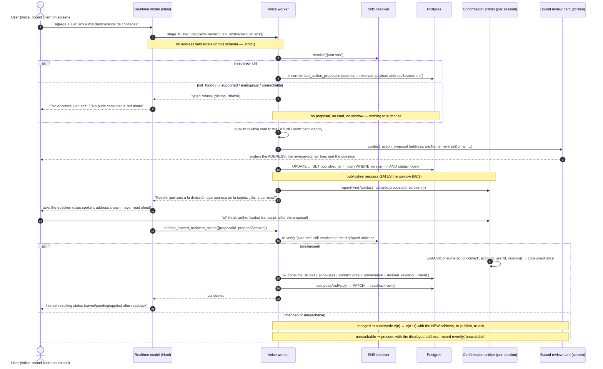

# Design discussion — add a trusted recipient by SNS alias (stage 1, revision 1)

Status: proposal awaiting Ramiro's approval. **The spec revision in §1 is the part that must be
approved before anything else moves.** No code, no dependency, no spec file, no remote mutation
by this artifact.

Worktree `/Users/ramiro/Desktop/projects/colloseum.feat-solana-operational`, branch
`feat/solana-operational`. Inputs: `00-intake.md` rev 1, `01-sns-devnet-resources.md`, the
published artifacts of `openspec/changes/trusted-recipient-policy-sync/` (spec, design, tasks) and
the code seams listed in §0.

The product decision this designs for, in Ramiro's words:

> "que resuelva cuando lo agregás pero que no te pida la dirección para agregarlo, simplemente vos
> decirle `juan.sns` para agregar ese contacto y después Nani pregunta: la dirección que aparece en
> pantalla, ¿es la correcta? y ahí le confirmamos."

So: **the alias is the input; the resolved address is what the user confirms and what gets
authorized.**

---

## 0. What this design was written against, and what I did not run

Honesty first, because the credibility of §1 depends on it.

**Read (source of truth for every path, symbol and constant below):**

| Artifact | What it gave me |
| --- | --- |
| `openspec/changes/trusted-recipient-policy-sync/spec.md` | the exact clause being revised (§1.1) |
| `…/design.md` §3.1–§3.5, §7, §8.1–§8.4, §9.1–§9.2, §10, §11, §12 | the composer, the arbiter, the card, the contract delta, the diagram style |
| `src/memory/address.ts` | `isValidSolanaAddress`, `isValidRecipientAddress`, `CONFIGURED_RECIPIENT_NETWORK` |
| `src/wallet/policy/composer.ts` | `ComposeInput`/`ComposedPolicy`, `composedRulesHash`, the pure-function contract |
| `src/wallet/policy/service.ts` | the strict schemas, `RecipientContactWriteInput`, `create`/`edit`/`remove`, `replayIdempotentMutation` |
| `src/wallet/policy/contact-actions.ts` | `payloadSchema` (`addressSource: review_required\|pasted\|scanned`), `stage`, `replaceAddress`, `consumeInTransaction` |
| `src/livekit/contact-proposal-publication.ts` | the card payload, `contactProposalSummary`, `REVIEW_CHANNEL_MESSAGE`, publication-gates-window |
| `src/api/contact-actions.ts`, `src/contracts/http.ts` | `GET /v1/contact-actions/:proposalId`, `POST …/address`, the mirrored schemas |
| `apps/nana-wallet/src/features/wallet/ContactActionProposalCard.tsx`, `AddTrustedRecipient.tsx`, `ContactActionProposalReview.tsx` | the two real confirmation surfaces |
| `src/db/migrations/001`, `005`, `012`, `015`, `016` | `recipients.provenance JSONB`, `recipient_versions`, `contact_action_proposals` (incl. `address` made nullable by `016`) |
| `src/wallet/solana-devnet-provider.ts` | `SOLANA_DEVNET_NETWORK`, `SOLANA_DEVNET_RPC_URL` |
| `package.json` | `@solana/web3.js@1.98.4` present; **no `@bonfida/spl-name-service`** |

**Not done, and therefore not claimed:** no dependency installed, no `npm install`, no live RPC
call, no reverse-lookup call, no build, no test run, no spec/config/`src/` edit. The two live
devnet names, their addresses, the PDA headers and the devnet root are taken from
`01-sns-devnet-resources.md`, which records them as verified on-chain; the
`getPrimaryDomain → "The primary account does not exist"` observation is reported by Ramiro in the
task brief and is **not reproduced here**, because the SDK is not installed in this worktree. Every
place below where that matters is marked.

---

## 1. The spec revision — THE SECTION TO APPROVE

### 1.1 The exact clause being changed

`openspec/changes/trusted-recipient-policy-sync/spec.md`, capability
`voice-transfer-confirmation`, requirement *Voice permission creation requires a published proposal
and a verified address*, body sentence two:

> Creating a permission or replacing an address MUST require a verified pasted or scanned address;
> a spoken-only, inferred, or **name-derived** address MUST NEVER be a permission source.

and its second scenario, in full:

> #### Scenario: Name-derived address is never accepted
>
> - **Given** a model attempt to derive an address from a contact name or description
> - **When** the mutation is validated
> - **Then** the address is rejected as unverified evidence
> - **And** no contact or permission change occurs

The same rule is restated in three other homes, and the revision is **partial unless all four move
together** — leave any of them and the artifacts contradict each other:

| Home | Text |
| --- | --- |
| `spec.md` (capability `unified-agent-tools`) | "they MUST NOT accept an arbitrary address, a network, a policy identifier, a signer, or a cap from the model" — *unchanged, and it must stay unchanged* |
| `design.md` §8.3 | "The address is never a spoken value and never derived from a name" |
| `design.md` §8.3 | "the address enters a proposal by exactly two routes: (1) the HTTP path, (2) the review channel" |
| `proposal.md:43` | "Spoken/inferred addresses are never a permission source: creation and address replacement require a verified pasted/scanned address, and no address is ever derived from a name." |

### 1.2 The distinction the revision must draw, or it is a blanket weakening

The current clause forbids one thing under one word. The revision has to forbid one thing and permit
another, and the two are **not** the same sentence with a different word:

| | Source of the address | Verdict |
| --- | --- | --- |
| **Inference** | The model, or any client, produces an address out of a name, a description, a spoken utterance, or its own reasoning | **Still forbidden. Unchanged.** `juan` → *"so the address must be…"* is exactly what must never happen. |
| **Resolution** | The **server** looks up an **explicit `.sns` name the user supplied**, reads the destination from the chain, and the user confirms **that address as displayed** | **Newly permitted**, under the conditions in §1.3. |

The load-bearing part of the revision: the model still supplies no address, and it never will. What
changes is that a name the user typed or said out loud is no longer treated as a synonym for
"the model derived an address". The model passes a **name**; the server resolves it; the address
comes from the chain; the user authorizes the address.

Two structural guards already in the codebase make this distinction enforceable rather than
aspirational, and the delta keeps both:

- the recipient tools' schemas (`src/agent/definition.ts:113-124`) are `.strict()` and have **no
  address field** — so `snsName` can be added to the model's surface while `address` still cannot;
- the server-side address validator (`isValidSolanaAddress`, `src/memory/address.ts:10-18`) stays the
  last gate before persistence, so a resolver bug can never write a malformed key.

### 1.3 Proposed replacement text — ready to paste into a new change

This is the delta for a **new** change (`openspec/changes/sns-alias-recipients/`) that MODIFIES the
requirements published by `trusted-recipient-policy-sync`. Every requirement name and ID is reused
verbatim; no parallel ID is introduced.

---

#### MODIFIED Requirement: Voice permission creation requires a published proposal and a verified address

For the voice path the server MUST persist the contact-action proposal and publish it, with the
exact address, action, version, and revocation effects, to the bound authenticated conversation UI.
The voice authorization window MUST open only after that publication succeeds.

An address MUST reach a permission-creating proposal through exactly one of two verified sources:

1. an address the user **pasted or scanned** into the review channel; or
2. an address the **server** resolved from an explicit `.sns` name the user supplied, which the
   card then presented to the user **as that exact address**, bound to an immutable proposal
   version the user then confirmed.

A spoken-only address, a model-inferred address, or any address supplied as a model tool argument
MUST NEVER be a permission source. **In the alias path the alias is a label and the resolved address
is the authorization: what the user confirms and what the system stores and authorizes MUST be the
resolved address, never the alias.**

Without a bound visual client, or without one of those two verified sources, permission creation
MUST be refused, and the contact MAY be saved as not enabled.

*(Previously: creation and address replacement required a verified pasted or scanned address, and no
address was ever derived from a name.)*

##### Scenario: Model-inferred address is never accepted

- **Given** a model attempt to supply, guess, or infer an address from a contact name, a description, or any other spoken value
- **When** the mutation is validated
- **Then** the address is rejected as unverified evidence
- **And** no contact or permission change occurs

##### Scenario: Spoken-only address is still rejected

- **Given** an address that exists only in spoken input
- **When** permission creation is attempted
- **Then** the request is refused and a verified pasted, scanned, or server-resolved source is requested

##### Scenario: Server-resolved alias address is accepted only as displayed

- **Given** an explicit `.sns` name the user supplied and no address anywhere in the request
- **When** the server resolves it to a canonical base58 address and the card presents that exact address bound to an immutable proposal version
- **Then** the user's affirmative for that version authorizes exactly that address
- **And** the stored contact carries the resolved address, and the composed policy contains that address and not the alias

##### Scenario: The confirmed version is the only authorization

- **Given** a card for proposal version *n* presenting a resolved address
- **When** an affirmative arrives after version *n+1* was created
- **Then** it cannot authorize version *n+1*, and no address other than the one that version *n+1* displays can be consumed

##### Scenario: Unresolvable, unsupported or unreachable alias creates no permission

- **Given** an `.sns` name that does not exist, a suffix this deployment does not support, or a resolver that cannot be reached
- **When** permission creation is attempted
- **Then** the request is refused with a typed outcome that distinguishes "does not exist" from "could not be reached"
- **And** no contact is authorized and no address is invented to compensate
- **And** an unreachable resolver is never reported to the user as a non-existent name

##### Scenario: Absent bound visual client refuses permission creation

- **Given** a voice session with no bound visual client to receive the proposal card
- **When** the user asks to create a trusted recipient by alias
- **Then** permission creation is refused and the missing review channel is requested
- **And** the contact may be saved as not enabled

---

#### ADDED Requirement (capability `recipient-address-memory`): RAM-010 Alias-resolved addresses are frozen at add time with recorded provenance

An address resolved from an `.sns` name SHALL be validated exactly like any other recipient address
— a canonical base58 Solana public key scoped to `solana-devnet` — and SHALL be persisted with
provenance recording at least `{source:'sns', name, resolvedAt, resolver}`.

The stored address MUST NEVER be re-resolved for a payment, a preview, a composition, or an
automatic execution. A later change to what the name resolves to MUST be surfaced as drift and MUST
NEVER automatically update, replace, re-authorize, or revoke the stored address. An address edit on
an alias-origin contact SHALL rewrite or clear the alias provenance atomically with the address
change, so no stale alias claim survives an address the user replaced.

##### Scenario: The stored address is the frozen destination

- **Given** a contact created from an alias that resolved to address A
- **When** a later payment, preview, or composition for that contact runs
- **Then** address A is used and no resolution is performed

##### Scenario: A name that later resolves elsewhere is drift, never an update

- **Given** a stored alias whose name now resolves to address B while the stored address is A
- **When** the drift is observed
- **Then** the stored address remains A, the composition is unchanged, and no grant is revoked or created
- **And** the drift is recorded as evidence and reported to the user, with the user deciding whether to keep or replace

##### Scenario: Provenance is persisted and reported

- **Given** a contact created from an alias
- **When** the contact is read back
- **Then** its provenance records the alias name, the resolution time, and the resolver identity
- **And** the alias is never the stored payment target

##### Scenario: An address edit leaves no stale alias claim

- **Given** a contact created from an alias, whose address the user then replaces
- **When** the address change is composed
- **Then** the alias provenance is rewritten or cleared in the same transaction as the address change
- **And** no later drift comparison is made against an alias for the replaced address

---

### 1.4 What the change costs — stated plainly

With paste/scan, the user supplies the destination **from their own knowledge**. A compromised
resolution, a squatted name, or a lying RPC cannot redirect them, because nothing external chose the
destination: they did. The only failure mode is a typo or a malicious *scan*, which is why the
scanned path re-validates on the way in.

With alias resolution that property is **gone**. The address arrives wholly from the chain, and
display-and-confirm is the *only* check standing between a name and a trusted destination. And it
is a strictly weaker check, because it asks the user to verify something they are by definition
unable to verify: **the whole point of typing `juan.sns` instead of an address is that the user does
not know Juan's address.** A user who cannot recognize `3aHrqufW6h2hgmANwhXv6WnijdNiqjU7VbAWyLzGCUb2`
is being asked to approve it.

So the honest framing of this feature is: **the alias path is a convenience that cannot make the
confirmation stronger than the paste path, and it hands the destination choice to a third-party
registry.** Everything in §1.5 exists to bound that, not to pretend it away. Nothing in this design
turns `juan.sns` into proof of identity; the address is authorized because the user said yes to that
address, not because the chain said the address exists.

Two consequences that follow from the cost, and that should be accepted explicitly:

1. **The alias path is not for adversarial destinations.** It is safe for the case the product
   actually targets — an older user who has been *told* "mandale a juan.sns" and whose counterparty
   owns that name. It is not safe as a substitute for out-of-band verification, and the UI must not
   imply it is.
2. **Freeze-at-add-time is the strongest compensation, and it is structural, not cosmetic.** Once the
   address is stored, a later transfer or re-registration of the name cannot move money, because the
   name is never consulted again.

### 1.5 Compensations — and which are mandatory

The five compensations in the intake are not all of the same kind. This design splits them, because
"mitigations that are part of the design, not optional" and "which of these may be absent" are
different questions and the second one is the one that decides whether the feature is acceptable.

**MANDATORY — the feature must not ship without these, and each one has a named test:**

| # | Compensation | Why it cannot be optional |
| --- | --- | --- |
| M1 | **Server-side resolution, never a client or model address.** The alias is the only input; the address is produced server-side. | Otherwise the "source" is the client again and the whole distinction in §1.2 collapses. |
| M2 | **The resolved address is always shown, verbatim, in the confirmation — on the bound surface, bound to the immutable version the user confirms.** | This is the only check that exists (§1.4). If it is skippable, there is no check at all. |
| M3 | **Freeze + provenance written before the address is authorized.** `{source:'sns', name, resolvedAt, resolver}` on the contact row. | The freeze is what makes the name's mutability harmless. Without it, the address is mutable by a third party *after* consent. |
| M4 | **Drift is surfaced and never auto-followed.** No re-resolution at send time, ever. | Auto-following would re-introduce the mutable destination that M3 exists to remove. |
| M5 | **Typed, distinguishable refusals: "does not exist" ≠ "could not be reached".** | An unreachable resolver reported as "not found" is a false statement about the world, and it is the repo's own rule that a definite rejection and an ambiguous network failure are different (`AGENTS.md`). |
| M6 | **Confirm-time re-verification: a resolution that now differs from the displayed address fails closed and supersedes the proposal** (never silently adopts the new address). | Closes the transfer-between-resolve-and-confirm hole (§5). Fail-closed here costs nothing: the user re-confirms. |
| M7 | **The paste/scan path is retained, unchanged, on every surface.** | The alias is additive; a user who has the address keeps the stronger source. |
| M8 | **`.sns` only; other suffixes are a typed refusal, never a silent fallback.** | §7 rejects `.sol` for a documented, already-passed cutover. |

**OPTIONAL — genuinely present-or-absent, and the design must say which state it is in:**

| # | Compensation | Honest status |
| --- | --- | --- |
| O1 | **The reverse-domain signal** (the resolved address's primary `.sns` name, if any). | Present when it exists, and reported as **absent** — explicitly, never as agreement — when it does not. §4.3 explains why its absence is expected on devnet and why it must never be read as confirmation. |
| O2 | **The observation evidence on the resolution** (`nameAccount`, `observedOwner`, `slot`). | Recorded when the transport reports it; a richer audit trail, not a security control. |
| O3 | **A pre-confirmation freshness indicator on the card** ("resolver: sns/solana-devnet/v3"). | A transparency affordance. The guard is M6, not the label. |

The one optional item that must **not** be quietly promoted into a mandatory one is O1: making the
card's approval depend on a reverse domain existing would make the feature unusable on devnet (§4.3)
and, worse, would train the user to read "no primary domain" as a failure — which is exactly the
state an attacker wants to produce.

### 1.6 Second-order deltas the revision drags in

Approving §1.3 also approves these, and they should be listed in the new change's proposal so nobody
discovers them mid-implementation:

- `design.md` §8.3 changes from "two routes" to **three** (HTTP paste/scan, review-channel
  paste/scan, server-side alias resolution), and the sentence "never derived from a name" becomes
  "never *inferred* from a name; resolved from an explicit `.sns` name under §1.3's conditions".
- `proposal.md:43` is restated with the same distinction.
- A new dependency (`@bonfida/spl-name-service`) and a new module outside `src/wallet/policy/**`. The
  structural guards in `design.md` §3.3 (no second full-rule writer; `composeGrantRules` imported
  only by the composer) are **unaffected** — this change adds no rule writer — but a new structural
  assertion is needed in the opposite direction: `@bonfida/spl-name-service` must be imported by
  **exactly one module** (§2.1).
- New HTTP surface (§9.2 of the earlier design is extended, not replaced): one resolve endpoint, one
  alias-add arm on `POST /v1/contacts`, one drift-check endpoint. Both contract sides move in one
  work unit (`AGENTS.md`).

---

## 2. The resolver seam

### 2.1 The interface

New module `src/wallet/sns/` containing `resolver.ts` (pure orchestration + network mapping) and
`transport.ts` (the only file that imports the SDK and `@solana/web3.js`).

```ts
/** src/wallet/sns/resolver.ts */
export type SnsResolution = {
  name: string;            // canonical: lowercased label + ".sns", suffix required
  address: string;         // canonical base58; equal to the observed registry owner
  nameAccount: string;     // the name-account PDA that was read
  observedOwner: string;   // registry.owner, decoded from bytes 32..64 of the account
  observedParent: string;  // registry.parentName, decoded from bytes 0..32
  slot: number | null;     // observation slot when the transport can report it
  resolvedAt: string;      // ISO, from the injected clock
  resolver: string;        // e.g. "sns/solana-devnet/v3" — recorded in provenance
};

export type SnsReverseLookup = { name: string | null; unknown: boolean };

export type SnsResolveFailure =
  | { kind: "malformed_name"; reason: "empty" | "too_long" | "charset" }
  | { kind: "unsupported_tld"; suffix: string }
  | { kind: "not_found" }
  | { kind: "ambiguous"; detail: string }
  | { kind: "unreachable"; retryable: true; cause: "rpc_error" | "rpc_throttled" | "timeout" }
  | { kind: "resolver_misconfigured"; reason: "unknown_network" | "no_root" };

export type SnsResolver = {
  resolve(name: string): Promise<
    { ok: true; value: SnsResolution } | { ok: false; failure: SnsResolveFailure }
  >;
  reverseLookup(address: string): Promise<
    { ok: true; value: SnsReverseLookup } | { ok: false; failure: SnsResolveFailure }
  >;
};

export function createSnsResolver(deps: {
  transport: SnsTransport;
  network: string;              // the DEPLOYMENT's network, from the existing constant
  now?: () => Date;
}): SnsResolver;
```

Three decisions inside that type worth naming:

- **`resolve` never throws.** Every outcome is a returned union, so the caller's mapping to HTTP
  status, tool result and spoken sentence is total. An exception path here would be the one place a
  "could not reach the chain" could drift into "not found" (M5).
- **`address` is not a free string.** The resolver requires
  `isValidSolanaAddress(observedOwner) && address === observedOwner`, i.e. the address it returns is
  the one it *read*, validated canonically (`src/memory/address.ts:10-18`). It never decodes, trims,
  normalizes or repairs a value from anywhere else.
- **`observedParent` is part of the value, not an internal check.** It is the evidence that the name
  is a child of the root this deployment resolves under (the same check the intake used to prove
  `sophie.sns`/`nanatest.sns` are genuine TLD children), and it is what makes "wrong network" a
  refusal rather than an interpretation (§9). A resolution whose `observedParent` differs from the
  configured root is `ambiguous` — the deployment has no authority to say what that name means.

### 2.2 Transport and testability

```ts
/** src/wallet/sns/transport.ts — the ONLY module that imports @bonfida/spl-name-service. */
export type SnsTransport = {
  /** Derive the name-account PDA for `label` under this network's root. */
  deriveNameAccount(label: string): { pubkey: string };
  /** Read the raw 96-byte name-registry header, or null when the account does not exist. */
  readNameRegistry(nameAccount: string): Promise<
    | { data: Uint8Array; owner: string; slot: number | null }
    | null
  >;
  /** The reverse-lookup path (§2.4/O1). */
  readPrimaryDomain(address: string): Promise<
    | { kind: "present"; name: string }
    | { kind: "none" }               // classified absence — see §4.3
    | { kind: "unknown"; detail: string }
  >;
};
```

Why the transport is separate from the resolver, and why it is a hard rule rather than a nicety:

- the header decode is `parentName = bytes 0..32`, `owner = bytes 32..64`, `class = bytes 64..96` —
  the intake verified the two devnet names with exactly that layout, so the resolver's unit tests can
  use **real 96-byte fixtures** and never touch the network;
- the intake's own operational finding is that the public devnet endpoint throttles **per method**
  (`429 Too many requests for a specific RPC call`) and that the throttle is **path-dependent**
  (host `curl` succeeded while the same call inside the backend container was refused). A test loop
  against it does not exist. Making the transport injectable is therefore not architecture
  astronautics; it is the only way to test this feature at all;
- `SNS_RPC_URL` is the live-endpoint override, following the `BALANCE_RPC_URL` precedent verbatim
  (`src/wallet/balances.ts:250-252`: `environment.BALANCE_RPC_URL ?? SOLANA_DEVNET_RPC_URL`). Its
  absence is not a misconfiguration, it is the shipped default. Live end-to-end evidence needs a
  dedicated endpoint; that is a prerequisite recorded in §10, not an assumption.

*Rejected alternative:* resolve directly through `@bonfida/spl-name-service`'s `resolve()` with no
abstraction. It cannot work: `resolve()` derives the name account under `SNS_ROOT_DOMAIN_ACCOUNT`
from `constants.mjs`, which is the **mainnet** root `58PwtjSDuFHuUkYjH9BYnnQKHfwo9reZhC2zMJv9JPkx`,
so a devnet name is invisible to it (intake, "Resolution: works, but only mainnet names resolve").
Beyond that, an unabstracted `resolve()` would put a live RPC call inside every unit test of the
feature and make the failure taxonomy unrepresentable.

*Rejected alternative:* a process-wide resolver cache. A cache is a second source of truth for
"what does this name resolve to", and it can serve an address different from the one the user was
shown — precisely the divergence M6 exists to catch. Any memoization must be request-scoped, and the
design states that as a rule rather than leaving it to implementation taste.

### 2.3 Selecting the devnet root without a second source of truth for "which network are we"

The problem: the resolver needs a per-network root, the SDK's own default is the mainnet root, and
the repo already names its network in two places that happen to agree today —
`CONFIGURED_RECIPIENT_NETWORK = "solana-devnet"` (`src/memory/address.ts:26`) and
`SOLANA_DEVNET_NETWORK = "solana-devnet"` (`src/wallet/solana-devnet-provider.ts:33`), with
`src/wallet/policy/service.ts:117` re-exporting the first as `SOLANA_POLICY_NETWORK`.

**Decision:** the SNS module owns a **closed** network→root mapping and takes the network as an
input from `CONFIGURED_RECIPIENT_NETWORK` — the same literal the recipient validator and the policy
scope already use, obtained through the existing re-export, never re-declared:

```ts
/** src/wallet/sns/resolver.ts */
const SNS_NETWORKS: Record<string, { root: string; resolverId: string }> = {
  "solana-devnet": {
    root: "5eoDkP6vCQBXqDV9YN2NdUs3nmML3dMRNmEYpiyVNBm2",   // devnet SNS root
    resolverId: "sns/solana-devnet/v3",
  },
};
```

Properties this buys, each of which is why the alternative was rejected:

- **The network is still named once.** The module adds a *root for a network*, not a new way to
  decide which network we are on. There is no `SNS_NETWORK` env var, and no request/body field may
  carry one (the strict schemas already reject `network` values other than the derived scope,
  `src/wallet/policy/service.ts:141-145`).
- **An unknown network fails closed** as `resolver_misconfigured`, instead of falling back to the
  SDK's mainnet default. This is the anti-footgun that matters: a misconfiguration must never resolve
  user-facing names against a different cluster's root.
- **The mainnet root is deliberately not in the map.** Adding it would be a one-line commit that
  would enable mainnet resolution for a deployment that cannot sign mainnet transactions, and the
  `resolverId` string in provenance would then describe a network the wallet does not transact on.
  Adding it is a decision for whoever moves the deployment, not a default.

*Rejected alternative:* derive the root from the RPC URL (e.g. "if the endpoint contains `devnet`,
use the devnet root"). It couples a security-relevant derivation to an arbitrary string, and a
custom endpoint name (`https://my-rpc.example`) would resolve to no root at all while a proxied
mainnet URL would silently resolve against mainnet. Rejected.

*Rejected alternative:* hardcode the root as the single source and delete the constants. Then the
resolver would be the only place that knows the network, and a future second chain would have the
network name in a wallet module and the root in an SNS module — the drift problem this section
exists to avoid.

*Rejected alternative:* read the root from the RPC (`getAccountInfo` on the name's parent at
runtime, inferring the cluster). There is no reliable cluster-identity method on the standard RPC
surface, and inferring it from which root happens to exist would make resolution depend on a race
between two deployments.

### 2.4 Failure taxonomy — and what each failure does to the UI and the agent

The mapping is deliberately not "one error type → one status". Two of these are security-relevant
distinctions and both are asserted by tests.

| Failure | HTTP | Screen | Voice / text agent (Nani) | Effect on contact & permission |
| --- | --- | --- | --- | --- |
| `malformed_name` (`empty`/`too_long`/`charset`) | `422 DATOS_INVALIDOS` | "Escribí un nombre `.sns` completo, por ejemplo `juan.sns`." No resolve call is attempted for an empty field. | Says the name is not usable as given; asks again. | Nothing staged, nothing persisted. |
| `unsupported_tld` (e.g. `.sol`) | `422 NOMBRE_NO_SOPORTADO` | "Ese sufijo no está disponible. Solo `.sns`." | Says the same, names `.sns` as the only accepted suffix. | Nothing staged. **No fallback attempt with another suffix** (§7). |
| `not_found` | `404 NOMBRE_NO_ENCONTRADO` | "No existe `juan.sns` en esta red." | Nani says it plainly; suggests checking the name or pasting the address on screen. | Nothing staged; no card is published; no window opens. Fail closed. |
| `ambiguous` (`observedParent` ≠ configured root, or an unrecognized header shape) | `409 NOMBRE_AMBIGUO` | "No puedo confirmar qué dirección le corresponde a ese nombre." | Same, and offers the paste/scan path. | Nothing staged. Never resolved "as best we can". |
| `unreachable` (`rpc_error`/`rpc_throttled`/`timeout`) | `503 RESOLVEDOR_NO_DISPONIBLE` | "No pude consultar la red. Probá de nuevo o pegá la dirección." Retry affordance; last successful resolution, if any, stays visible **labelled with its age**. | "No pude consultar la red ahora. Probá de nuevo en un momento o pegá la dirección en la pantalla." | **Nothing staged, nothing persisted, and explicitly NOT reported as a non-existent name (M5).** |
| `resolver_misconfigured` | `503 RESOLVEDOR_NO_DISPONIBLE` + `503`-class reason in the audit | "El servicio de nombres no está configurado." | Same, without inviting a retry loop. | Nothing staged; a `blocked_configuration`-class operational stop. |

Reverse lookup is classified separately and **never blocks the alias flow** (O1):

| Reverse result | Card | Meaning |
| --- | --- | --- |
| `present` | "Ese nombre figura también como nombre principal de la dirección." | Corroboration: the address's owner also controls the name. |
| `none` | "La dirección no tiene un nombre principal registrado." | The expected devnet case (§4.3). **Not** a failure, **not** disagreement, and **not** a reason to refuse. |
| `unknown` (error shape not recognized as "no primary domain") | "No pude verificar el nombre principal de esta dirección." | Reported as *unknown*, never degraded to `none`. |

The `unknown` row is the one that needs care in implementation and gets its own test: an
unrecognized error must not be classified as absence, because absence is the state that reads as
"nothing to see here" to the user.

**`ambiguous` is honestly under-specified and I am labelling it instead of inventing it.** The two
conditions given are derivable from the intake's own verification recipe (parent not the root;
header not decodable), and the second is what the intake's "the name is a genuine TLD child"
check would catch. I could not construct a *third* realistic ambiguity from the material available,
and neither name we own is ambiguous. It therefore exists so the code has a named, typed refusal
rather than an exception path, and §11 records the missing fixture as an open question rather than
pretending it is designed.

### 2.5 SDK version — the tradeoff, stated rather than assumed

The repo has **no** `@bonfida/spl-name-service` in `package.json` (verified). The working devnet
registration path uses **v3.0.23**; the rest of the SNS work would prefer **v4.0.1**; the two are not
backward compatible (intake).

| | v3.0.23 | v4.0.1 |
| --- | --- | --- |
| Devnet name-account derivation | `devnet.utils.getDomainKeySync(label)` — **works**, and is what the live registration recipe uses | renamed to `getSnsDomainKeySync`; **no devnet resolver is exported** |
| Mainnet `resolve()` | present, mainnet-bound | present, mainnet-bound, `safeResolve` too |
| Devnet payment config (`PYTH_FEEDS`, `PYTH_MAPPING_ACC`, `REFERRERS`) | present (this is why registration works) | dropped — `PythFeedNotFoundError` on devnet |
| `@solana/web3.js` | 1.x — matches the installed `1.98.4` | 1.x for the version researched, but the sibling kit `@solana-name-service/sns-sdk-kit` would add the `@solana/kit` stack |

**Decision: v3.0.23 for this slice.** Rationale, and the cost, in one place:

- It is the **only** version that can derive a devnet name account, and this deployment is devnet-only
  (`AGENTS.md`: one configuration, Solana devnet through Privy, no mode switch). v4 cannot resolve a
  devnet name at all, so choosing v4 today would mean shipping an alias feature that cannot be
  exercised on the only network the product runs on.
- It keeps **one** `@solana/web3.js`, the installed 1.98.4. The alternative
  `@solana-name-service/sns-sdk-kit` was already rejected by the intake for dragging in a second
  Solana stack; the same reasoning applies with more force to a second stack *plus* a second SDK line.
- **Cost, stated:** v3 is the legacy line, `.sol` support is being removed from both, and a move to
  mainnet re-opens this decision (a mainnet deployment would want v4 and its `resolve`). The design
  confines the blast radius to `src/wallet/sns/transport.ts` — one module, one dependency — and
  version-tags every stored provenance record as `sns/<network>/v3`, so a future change is **visible
  in the data** instead of silent.
- **Install costs that are prerequisites, not decisions:** `npm install @bonfida/spl-name-service`
  needs `--legacy-peer-deps` (peer conflict with `@circle-fin/developer-controlled-wallets@10.8.0`),
  and inside the backend container it must be installed **in** the container
  (`docker exec -w /app … npm install …`), because hand-copying `node_modules` fails transitively
  through `@bonfida/sns-records` → `@solana/spl-token`. Bundle-size impact is unmeasured (§11).

Two deployment facts that constrain what the resolver is allowed to *do* (both from the intake, both
architectural):

- **The app wallet cannot sign a name registration** — `Privy denied the Solana dispatch by policy`,
  because the single ALLOW rule covers a SystemProgram `Transfer` only. This feature is unaffected
  because **resolution is a read and reads are unrestricted**; but it is why no part of this design
  registers, sets a primary domain, or writes anything on-chain. If a future slice wants
  "register a name from the app", that is a deliberate policy change, not a side effect of this one.
- **A name owner is arbitrary.** `sophie.sns` resolves to Sophie because Sophie's own keypair paid for
  it; `nanatest.sns` resolves to the payer. The resolver must never assume the destination belongs to
  us, and no test may assert that it does.

---

## 3. Freeze-at-add-time and the provenance record

### 3.1 Where `{source:'sns', name, resolvedAt, resolver}` is persisted

**`recipients.provenance`.** It already exists as `JSONB NOT NULL DEFAULT '{}'::jsonb`
(`src/db/migrations/001_recipient_memory.sql:15`) and is already written from
`RecipientInput.provenance` (`src/memory/repository.ts:117-121`). No new table and no new column:

```jsonc
// recipients.provenance for a contact added by alias
{
  "source": "sns",
  "name": "juan.sns",
  "resolvedAt": "2026-10-10T18:04:11.482Z",
  "resolver": "sns/solana-devnet/v3",
  // evidence (O2), present when the transport reported it:
  "nameAccount": "…",
  "observedOwner": "…",          // == recipients.address, recorded as read
  "observedParent": "5eoDkP6vCQBXqDV9YN2NdUs3nmML3dMRNmEYpiyVNBm2",
  "slot": 509688088,
  "reverseDomain": null,
  "reverseDomainState": "none"   // 'present' | 'none' | 'unknown'
}
```

The four keys in M3 (`source`, `name`, `resolvedAt`, `resolver`) are what the spec names; the rest are
evidence. Keeping evidence inside the same object means one read path and no join.

The write path needs one concrete extension, and it is small:

- `RecipientContactWriteInput` (`src/wallet/policy/service.ts`) is currently
  `{name, description, address, network}`. It gains `provenance?: Record<string, unknown>`, passed
  through `RecipientContactMutationPort.create` to the existing `RecipientInput.provenance`
  parameter. That is the whole plumbing: **one optional field on one port**, and no new repository
  method.
- The alias arm of the create path is the only caller that sets it. The paste/scan path keeps
  sending whatever it sends today (see the decision below).

**Decision (small, but it needs saying):** the paste/scan path records
`{source:'pasted'|'scanned'}` in the same object, so that "what was this address's source" has one
vocabulary instead of "an object for aliases, nothing for everything else". *Rejected alternative:*
leave the paste path at `{}` and make `source:'sns'` the only possible value. It would mean the
absence of provenance is ambiguous between "pasted" and "written before this feature existed", which
is exactly the kind of ambiguity that later gets read as a security property. The cost is that
`contact-actions.ts`'s `payloadSchema.addressSource` enum
(`["review_required","pasted","scanned"]`) widens to include `"sns"` — an additive enum widening on
a JSONB payload with no CHECK on its keys (migration `016`), so no migration is needed.

**A known gap, recorded rather than fixed here:** `recipient_versions` snapshots `name`,
`description`, `address` and `network` — **not** `provenance`
(`src/db/migrations/005_recipient_versions.sql:6-14`). So after an address edit, the history shows
the old address but not "what that old address was, and where it came from". §6 makes the atomic
provenance rewrite mandatory, which bounds the damage to the history table; extending the snapshot is
§11 Q5 rather than scope creep, because it changes an out-of-scope table that is `INSERT`-only under
RLS.

### 3.2 How it relates to the existing consent provenance — and why the composer does not change

There are now **three** things called provenance in this codebase, and confusing them is the
easiest mistake to make here. They are different in kind:

| | What it is | Who writes it | Who reads it | Changes in this design? |
| --- | --- | --- | --- | --- |
| `recipient_policy_state.consent_provenance` | The **enrollment** snapshot: written once from the wallet's newest `state='active'` `signer_grants` row and never re-derived (`design.md` §2.1) | the enrollment capture, once per wallet | recorded as evidence; the composer carries it without interpreting it (`composer.ts:57-67`) | **no** |
| `ComposedPolicy.provenance` | `Record<address, 'baseline'|'contact'|'grant'>` — **membership**, computed by the pure composer, used by readback check (d) | `composePolicy` | the readback comparator | **no** |
| `recipients.provenance` | **Per-contact** durable provenance: where this address came from | the contact write port | the contact read/report surface, the drift check | **yes — this is the new one** |

**The composer keeps consuming addresses, unchanged.** Its contact input is
`Array<{id, version, address}>` (`composer.ts:99-101`); it never sees a name, and after this change
it still never will. Three consequences, each deliberate:

1. **The allowlist is unaffected.** `ordinaryRecipients = sortedUnique(baseline ∪ contact addresses)`
   — an alias-created contact contributes exactly its resolved address, the same as a pasted one. The
   0.01 SOL ceiling, the grant rules, the `applied_rules_hash`, the readback comparator, and
   `applied_recipients` all see zero difference. This is the strongest single argument for
   freeze-at-add-time: **the entire policy machinery is destination-agnostic, so the alias feature
   needs no change to it at all.**
2. **Nothing about SNS reaches `src/wallet/policy/**`'s rule path.** The structural guards in
   `design.md` §3.3 stay intact. The SNS module is a *pre-persistence* concern, the same category as
   `isValidSolanaAddress`.
3. **The alias can never become a payment target by construction**, because there is no code path in
   which a name (rather than an address) reaches a rule.

### 3.3 Drift detection

**What it is.** The stored provenance names `juan.sns`; later, `juan.sns` resolves to address B while
the stored address is A. That is drift. It is a **fact to report**, not a state to converge.

**When it is checked — deliberately bounded, with two rejected alternatives:**

| Trigger | Chosen? | Why |
| --- | --- | --- |
| **Confirm time**, on the alias being added | **Yes** | Mandatory (M6). Costs one read on a path that already performed one, and closes the resolve→confirm transfer window. |
| **On demand**, when the user asks | **Yes** | `POST /v1/contacts/:id/check-alias`, an explicit, bounded, single-contact read. Cheap, testable, and it puts the read where a human is already looking. |
| On `GET /v1/contacts` (list read) | **No** | It would put N RPC reads on a read path, make the contact list fail or slow because of a third-party registry (§9), and change a read into a write (drift evidence) — a GET with side effects. |
| At transfer preview or send time | **No** | The intake forbids re-resolution for a payment, and it would re-introduce the mutable destination. This is M4 and it is absolute. |
| A background daemon | **No, in this slice** | No periodic job exists in this feature's scope, and adding one is a new operational surface. §11 Q7. |

**What happens when drift is found:**

- The stored address is **unchanged**. Nothing is recomposed, no revision advances, no grant is
  revoked, no preview is invalidated. A payment to that recipient still goes to A, which is what the
  user authorized.
- Evidence is recorded: `recipients.provenance.drift = {observedAddress, observedAt, resolver}` plus
  an append-only `recipient_policy_audit` row with an `alias_destination_changed` event. That event
  value widens the audit's CHECK list (see §11 Q4 for the alternative considered).
- It is **reported**, on both surfaces, in the shape that keeps the user's authority intact:
  *"`juan.sns` ahora apunta a otra dirección. Tu destinatario de confianza sigue siendo
  `<stored address>`; no cambié nada."* The user's options are **keep**, **replace** (a full address
  edit: disclosure, recomposition, and the atomic provenance rewrite from §6), or **remove**.
- **Drift never blocks a payment.** This is a deliberate choice against the tempting "fail closed"
  reflex: a third party who transfers or re-registers a name must not be able to disable the user's
  trusted recipient. Blocking on drift would hand a stranger a denial-of-service lever over the
  user's own payment ability. The security property is already intact — the destination cannot move —
  so the correct response is information, not a lock.

**Why it must never auto-follow.** If a later resolution could update the destination, then the
destination would be mutable by whoever controls the name, and consent would be to *a name* rather
than *an address*. That inverts everything above: the composed allowlist would change without a user
action, `applied_rules_hash` would drift from `desired_rules_hash`, the readback comparator (§5.1)
would report a rules mismatch, the grant gate's six predicates would fail and every sibling grant of
that wallet would degrade to manual confirmation — i.e. **auto-follow would not merely be unsafe, it
would break the policy-integrity machinery that `trusted-recipient-policy-sync` just built**. That is
the deepest reason M3/M4 are mandatory.

---

## 4. The confirmation UX, both surfaces

The product sentence is "Nani pregunta: la dirección que aparece en pantalla, ¿es la correcta?" —
which is precisely the shape the existing machinery already has, because `design.md` §8.3 already
forbids the spoken narration from containing a raw address and already makes the **card** the place
an address becomes real. The alias path rides that seam instead of adding a second one.

### 4.1 Screen (`AddTrustedRecipient.tsx`)

The create form is two `Input`s (`AddTrustedRecipient.tsx:250-264`: name, address) and one
`api.createContact({name, description, address, network:'solana-devnet'})` call (`:132-137`), with a
client-side `solanaAddressPattern` pre-check (`:19-23`, `:110-111`).

**Design — one field, one resolve, one save, no new confirmation ceremony:**

1. The address field accepts either form. A value containing `.` is treated as a name candidate; a
   base58-shaped value stays the paste path. An explicit "Buscar" (resolve) action appears for the
   name form; the user does not have to guess that a second button exists.
2. Resolve calls `POST /v1/recipient-aliases/resolve` (`{name}`, strict). On success the field
   area shows, from the server response and nothing else:
   - the resolved address, verbatim and **not truncated** — this is the thing being authorized;
   - the reverse-domain line in one of its three honest states (§4.3);
   - a **confirmation question**, worded as the product asks it: *"¿La dirección que aparece acá es
     la correcta para `juan.sns`?"*
3. "Guardar" is enabled only after a successful resolution, and posts the **alias arm**:
   `{source:'sns', name:'juan.sns', expectedAddress:'<what was displayed>', description, network}`.
4. The server re-resolves and **requires equality** with `expectedAddress` (below). The contact is
   created with the server's resolved address and the provenance record.

**The load-bearing detail: `expectedAddress` can only ever veto, never choose.** The stored address is
the one the server resolves; `expectedAddress` is compared against it and a mismatch is a typed
`409 SNS_DESTINO_CAMBIADO` with nothing written. So the client cannot inject a destination, and —
the part that matters — the server cannot silently write an address the user never saw. That equality
check is what makes "the user confirmed *that* address" a checkable statement on the screen path,
where there is no proposal/window machinery to bind it. *Rejected alternative:* post `{snsName}` alone
and let the server write whatever it resolves. Simpler by one field, and it converts the human
confirmation into decoration: between the preview and the submit, a name transfer would silently
change the stored destination.

**Edit path:** unchanged in mechanism. If the user edits only the display label, `provenance` is
untouched (see §6, invariant 3). If the address changes, the existing flow applies — the pre-flight
removal preview for the affected grants (`AddTrustedRecipient.tsx:116-129`), the disclosure, then
`updateContact` — **plus** the atomic provenance rewrite.

**Card surface.** The alias path on the voice/text side reuses
`ContactActionProposalCard.tsx` with three additive lines, all from the persisted row (the component's
stated invariant):

- alias line: *"Este destinatario se agregó por `juan.sns`."*
- reverse-domain line (§4.3), three states;
- the address line it already renders (`:180`), unchanged — which is why this component needs almost
  nothing: `proposal.address` is already the resolved address.

### 4.2 Voice / text (Nani)

**Nothing about the gating changes, and that is the point.** The sequence stays exactly what
`design.md` §8.1/§8.2 built:

```
stage → persist proposal → publish card to the BOUND participant → await delivery →
mark published → arbiter.open(contact window) → authenticated affirmative → consume once
```

The alias enters at `stage`, and only there:

- **Model surface.** `contactCreateInputSchema` (`src/agent/definition.ts:113-116`) gains an optional
  `snsName` (`.strict()` retained; still no `address`, no `network`, no `policyId`). The model may
  pass a name it heard — *"agregá a juan.sns"* → `{name:'Juan', snsName:'juan.sns'}`. It can never
  pass an address, so §1.3's forbidden inference has no surface to travel on.
- **Resolve before persisting.** The service resolves the name first (I/O, outside any transaction).
  On failure the tool returns the typed refusal and **no proposal is created and no card is
  published** — so a broken name produces a spoken sentence, not a broken card. On success the
  proposal is persisted *with* the resolved address and `payload`
  `{addressSource:'sns', snsName, resolvedAt, resolver, reverseDomain, reverseDomainState}`.
- **The card carries the address**; the arbiter window opens only after successful publication, so
  the user is looking at that address when they say yes.
- **The spoken question asks about the screen, not about the address.** The tool result message
  becomes the server-owned sentence the model relays: *"Resolví `juan.sns` a la dirección que
  aparece en la tarjeta. ¿Es la correcta?"* — the alias is spoken, the address is shown. This is
  Ramiro's sentence, and it is also the only version that is consistent with the existing
  "never read a raw address aloud" rule.
- **The affirmative authorizes that address.** `confirm` is unchanged: `currentOpenProposal` →
  version match → `waitAndConsume({kind:'contact', actionId, userId, version})` → the persisted
  one-use UPDATE inside the mutation transaction. An alias-origin proposal is not special there, and
  should not be.
- **No bound visual client ⇒ refusal, unchanged.** `createVoiceContactActions.stage` already returns
  `address_review_required` with `REVIEW_CHANNEL_MESSAGE` when `boundParticipantIdentity` is absent
  (`contact-proposal-publication.ts`). That guard now carries *more* weight: for the alias path it is
  the only thing preventing a spoken name from becoming a permission with no displayed address at
  all. It must not be relaxed, and the spec keeps its scenario.

*Rejected alternative:* let the voice path create the contact on the alias alone when there is no
bound client, "because the name is safer than a spoken address". It is not: with no display, the user
never sees the destination, so it is M2 removed while keeping the weaker source. Rejected.

*Rejected alternative:* have the model read the resolved address aloud so the user can verify by
ear. Beyond contradicting the existing narration rule, it is the weakest possible check — base58
strings are unmemorable, and a "read it back" ceremony trains the user to say yes to a string they
cannot evaluate.

### 4.3 When the address has **no** reverse domain — the case that must not be assumed away

The intake reports `getPrimaryDomain` failing with **"The primary account does not exist"** for a
real address. I did not reproduce that call (§0), so the design treats it as the reported shape and
makes the classification explicit rather than incidental:

**Three states, three different sentences — never collapsed:**

| State | Card / screen text | Rationale |
| --- | --- | --- |
| `present` | "El nombre principal de esta dirección es `juan.sns`." | Corroboration. |
| `none` | "Esta dirección no tiene un nombre principal registrado." | **This is the expected state on devnet** (below), and the sentence must read as a fact about the chain, not as a warning and not as agreement. |
| `unknown` | "No pude verificar si esta dirección tiene un nombre principal." | An unrecognized error shape. Must never be rendered as `none`, because `none` is the state that reads as "nothing to see here". |

**Why `none` is the expected devnet state, and why the signal is weaker than it looks even when it is
`present`:**

- The two devnet names were registered through the **legacy registrar**. Nothing in
  `01-sns-devnet-resources.md` records a primary-domain call, and reverse lookup derives a PDA whose
  parent is the `REVERSE_LOOKUP_CLASS` seed `7NbD1vprif6apthEZAqhRfYuhrqnuderB8qpnfXGCc8H` — which
  the intake explicitly warns has no account on devnet **by design, because it is a derivation class
  seed, not a live account**. So a failed `getAccountInfo` on that constant is *not* evidence that
  reverse lookup is broken. The honest position: reverse lookup is probably available on devnet, and
  the primary domain almost certainly was never set, so the demo will most likely show `none`. That
  is unverified either way (§11 Q2).
- Even when `present`, its defensive value is narrower than it first appears. To set an address's
  primary domain you must control **that address**, and to have it read back as `juan.sns` you must
  also control **`juan.sns`** — so a mutual pair (`juan.sns → X`, `X → juan.sns`) is mutually
  self-consistent, and a squatter who owns `juan.sns` and points it at their own address X will
  produce exactly that pair. The signal therefore does **not** defend against a squatted name. It
  defends against a *forward-lookup subversion* — a lying RPC or a substituted answer — because a
  substituted address would rarely carry `juan.sns` as its primary name. Stated plainly: it is a
  useful second signal against transport-level tampering, and it is useless against the user-facing
  threat in §9, and it is absent precisely in the case where the user has nothing at all to compare.
- Therefore O1 stays optional and the design must never present it as the check. The checks that
  carry the weight are M2 (the address shown), M3 (the freeze) and M6 (confirm-time equality).

---

## 5. Validity window and idempotency

A name can be re-registered or transferred between resolve and confirm. §1.5's M6 fixes the rule;
this section justifies it and marks its residual.

**Decision: the resolved address IS re-verified at confirm time, and a difference fails closed by
superseding — never by adopting.**

Timing and placement, which is where this decision is easy to get wrong:

```
resolve at stage            (I/O, no transaction)
persist proposal v(n)       (address = the resolved one)
publish card, open window
───────────────────────────────  user reads, then speaks/taps
re-verify at confirm        (I/O, no transaction)
  ├─ equal          → proceed to the consume transaction
  ├─ differs        → supersede v(n), create v(n+1) with the NEW address, re-publish,
  │                   window re-opens ONLY for v(n+1); the user re-confirms what is now displayed
  └─ unreachable    → proceed with the displayed address, record reverify:'unavailable'
consume + mutate            (one transaction, address = the displayed one)
```

Four points that make this consistent with what already exists rather than a new mechanism:

1. **Remote I/O stays outside the transaction.** `design.md` §1.2/§1.4 and the spec's "Remote I/O
   stays outside the contact transaction" both apply. The re-verification happens before the consume
   transaction, exactly as the resolver call at `stage` does.
2. **A difference produces a NEW immutable version — the `replaceAddress` shape, not a new shape.**
   `ContactActionService.replaceAddress` (`contact-actions.ts`) already does precisely this:
   supersede the old row, insert `version + 1` with `supersedes_id`, re-validate, force the new
   version's `published_at` only after a successful re-publish, and let the window re-open only for
   the new version (`api/contact-actions.ts`). Drift-at-confirm is the same situation with a
   chain-derived new address, so it reuses that path with `addressSource:'sns'` and the new
   resolution's evidence. The user sees the new address and answers again.
3. **This is the existing "stale version fails closed" rule, applied on the way in.** The spec's
   "Stale version fails closed" and `contact-proposal-publication.ts`'s `matchesCurrent` check both
   say the same thing: a version that is not the current open one is never consumed. Superseding
   makes the old version *not current* by construction, rather than by a special case.
4. **The residual is stated, not hidden.** Between the re-verify and the commit there is a window of
   milliseconds in which a transfer could occur. It is not closable without putting an RPC call
   inside the transaction (forbidden) or trusting a slot/blockhash it cannot verify. It does not
   matter, and this is the reason: the user confirms an **address**, the stored destination is that
   address, and a name transferred after the confirmation cannot move money (M3). The re-verify
   exists to prevent confirming an address the name no longer points to — an honesty property — not
   to prevent a redirection, which the freeze already prevents.

**Why not simply fail closed on *any* re-verification failure.** Because the devnet RPC throttles per
method and path-dependently (intake §7): making the confirmation of a *displayed, already-authorized*
address depend on a fresh RPC read would let a throttled endpoint block the user from adding a
contact they are looking at. The re-verify is a **divergence detector**, not an authority gate — it
cannot widen anything, because nothing is authorized except the address the user was shown. So the
asymmetry is deliberate and is worth stating in the code comment: *difference ⇒ fail closed;
unreachable ⇒ proceed with the frozen address, labelled `reverify:'unavailable'`.* The rejected
alternative (any failure ⇒ refuse) is recorded because it is the "safer-sounding" choice and someone
will ask for it.

**Proposal TTL.** The existing 5-minute TTL (`ContactActionService` `ttlMs = 5 * 60_000`) already
bounds the window, and the screen preview carries the same bound. But the TTL is an **affordance, not
the guard**: the guard is the re-resolve equality at confirm. A preview submitted an hour later is
still safe, because the server resolves again and compares.

**Idempotency — one real gap, found while writing this.**

What exists: `Idempotency-Key` is stored as `recipient_policy_sync_intent.idempotency_key`, unique per
wallet (`src/db/migrations/015_recipient_policy_sync.sql:144-146`), and a replay returns the stored
result without a second composition, PATCH, or audit row (`service.ts:921-948`).

What that means for the alias path, precisely: `replayIdempotentMutation` looks up the intent by
`(wallet_id, idempotency_key)` **only** (`service.ts:936-940`,
`repository.readIntentByIdempotencyKey`) and returns the stored contact. There is **no body binding**:
a replay carrying the *same key* with a *different body* — a different alias, or a different
`expectedAddress` because the name moved between the two attempts — would silently return the first
result. For the paste path that is invisible (the body is the address, and the effective outcome is
the same contact). For the alias path it is user-visible and wrong: the client asked to add
`maria.sns`, and got a success referring to the contact created for `juan.sns`.

**Required behaviour (new, and it belongs in this change's design):** a replay whose request body
differs from the body that produced the stored intent MUST be refused with a typed
`409`-class conflict, not answered from the stored result. The cheapest faithful implementation is to
persist a hash of the canonical mutation body on the intent row and compare it on replay — noting
that `composed_hash` is the composed-policy hash, not a body hash, so it cannot serve this purpose
(§11 Q6). Without this, idempotency is a correctness hole the alias path exposes rather than creates.

---

## 6. Interaction with the existing invariants

Each row answers: preserved, extended, or deliberately revised — with the reason and the guard.

| # | Invariant | Verdict | How |
| --- | --- | --- | --- |
| 1 | `isValidRecipientAddress` requires a canonical base58 Solana key scoped to `solana-devnet` | **Preserved, and extended upstream** | The resolved address must satisfy the *same* validator (`derivedAddressSchema`, `service.ts:141-145` → `isValidRecipientAddress` → `isValidSolanaAddress`, `address.ts:10-18`), and the resolver additionally requires it to equal the registry owner it read. The alias path adds a **pre-condition**, never a second validator: a resolver bug cannot write a malformed key because the existing gate is still the last one. |
| 2 | Duplicate-address deduplication ("two active contact aliases for the same address" is legal) | **Deliberately revised — and this contradicts the intake, so it needs Ramiro's call** | See below. |
| 3 | Metadata edits never broaden permission; address edits invalidate stale state and recompose | **Preserved, extended** | See below. |
| 4 | Voice permission creation requires a *verified* address source, published proposal first | **Deliberately revised in source, preserved in mechanism** | §1.3 widens "verified source" to include server resolution. Everything procedural is unchanged: the card is persisted and published before the window opens, the address is never a model argument, the address arrives server-side, one-use consumption is the same conditional UPDATE. The revision changes *which sources count*, not *how authorization works*. |
| 5 | Removal semantics, incl. last-active-alias revokes the affected whole grant | **Preserved verbatim** | An alias-created contact is an ordinary contact with an ordinary address. §2.3's reasoning applies: the policy machinery is destination-agnostic, so `remove` needs no awareness of aliases. One new sentence the UI owes the user: removing an alias-created contact **cannot** change the name on-chain and does not touch any SNS state, because we never registered, own, or control the name. |
| 6 | Empty composition never broadens authority | **Preserved** | Unaffected; an alias-created contact is a normal address in the ordinary allowlist. |
| 7 | Consent provenance derives from durable consent, never a remote GET | **Preserved, and reinforced** | `recipients.provenance` is a *human-confirmed* record written from the resolution the user saw; nothing in the design reads a name's current destination to decide consent. The drift check reads the chain and may only ever *report*. |

### Invariant 2 — the contradiction, stated plainly

The intake's acceptance evidence says refusal must be "typed and visible when … the resolved address
already belongs to another active contact (deduplication rule already in the spec)". **That clause is
not in the spec.** I checked: the spec's deduplication is at *composition* level
(`ComposePolicy`'s `sortedUnique`), and the removal requirement explicitly *supports* two active
aliases for one address — "Removing one alias MUST NOT revoke another active alias for the same
address", with a scenario that starts "Given two active contact aliases for the same address".
Nowhere does the published spec refuse a contact whose address another active contact already holds.

So this is a **new rule**, not an existing one, and it needs a decision because it is not obviously
desirable:

**Option A — refuse (what the intake asks for).** Adding `juan.sns` when its resolved address already
belongs to an active contact ("Mamá") fails with a typed conflict. *Cost:* it contradicts the
existing aliasing model, it creates an **asymmetry between the two sources** (the paste path would
either have to gain the same refusal — a behaviour change for an existing flow — or the alias path
becomes strictly more restrictive than the paste path for no security reason), and it removes a
legitimate use ("the same person is my mother and my accountant").

**Option B — disclose and proceed (recommended).** Add it, and show it plainly: *"Esta dirección ya
está en tu lista como Mamá. `juan.sns` apunta al mismo lugar; no cambia a quién le podés pagar."*
*Why I recommend it:* the security impact of a duplicate address is **nil** — the composed allowlist
is a set, so a second label for an address the user already trusts adds no authority, creates no
grant, and moves no ceiling (`composer.ts` `sortedUnique`). What it can do is confuse the user, and a
clear disclosure addresses confusion directly. It also keeps a single rule for both sources.

**What is mandatory either way:** the case where the resolved address is the **user's own wallet
address** is refused with a typed error. That is not a dedup question, it is the intake's stated
non-goal ("No aliases for the wallet's own address"), and it also catches a real misresolution class
(the intake's own `nanatest.sns` resolves to its payer, which is a name pointing at its owner rather
than at a third party). This one is unconditional.

**My recommendation: Option B + the self-address refusal.** Marked as a decision for Ramiro because
Option A is a second spec delta, not an implementation detail.

### Invariant 3 — metadata vs address edits

**The alias lives in `recipients.provenance`, never in `recipients.name`.** That is the decision, and
it is not cosmetic:

- `name` is a **user-owned display label** — freely renameable, used for the embedding and for
  `search_recipients`, and editable through the metadata path. If the alias were stored there,
  renaming "Juan" → "Juancho" would either silently change the string the drift check compares
  against, or make the drift check read a mutable field. Either way the freeze would depend on a
  field the user can edit for unrelated reasons.
- Consequence: **renaming never invalidates a freeze.** A metadata-only edit produces an identical
  composed rule set (held by the existing assertion at `service.ts:985`) and touches no provenance.
- Consequence: an **address edit must rewrite or clear the provenance atomically**, in the same
  transaction as the address change. Otherwise, after replacing the address with a pasted one, the
  stored provenance would still claim `juan.sns → <old address>`, and a later drift check would
  compare against an alias for an address the contact no longer has — reporting "no drift" for a
  name that has nothing to do with the current destination. The existing edit path already invalidates
  stale selections and previews and recomposes both addresses; the provenance rewrite is additive to
  that transaction, and it is the fourth scenario of the RAM-010 delta in §1.3.
- **The replacement address is validated exactly as before** (canonical base58), so an alias-origin
  contact is not a second-class citizen in the edit path.

---

## 7. Rejected alternatives

Beyond the alternatives recorded inline above (§2.2 memoization and no-abstraction, §2.3 root
selection ×3, §2.5 SDK and sdk-kit, §4.1 posting the name alone, §4.2 no-client fallback and
read-aloud, §4.3 reverse signal as the check, §5 fail-closed-on-any-reverify, §6 Option A vs B), the
five the brief requires, plus two more that came up while reading the code:

| # | Rejected | Why |
| --- | --- | --- |
| R1 | **Resolve at send time** | The name is an NFT and can be transferred, so `name → address` is mutable: the destination could change with no action by the user, and the user's consent would be to a name rather than an address. Worse, the composed allowlist is built from **addresses** (`composer.ts:99-101`, `ordinaryRecipients`), so a per-send resolution would force a remote policy PATCH on every send — a per-payment remote write on the money path, which is exactly what "resolve once, freeze" removes. It would also make the whole "stale version fails closed" family meaningless, since each send would need its own resolution and its own consent. |
| R2 | **Store the alias as the payment target** | A name is not an address and cannot be one in this system: the Privy rule carries `Transfer.to` addresses; `isValidRecipientAddress` requires 32 canonical base58 bytes; the grants ledger's `recipients` are address arrays (`delegated_grants.recipients @> to_jsonb(ARRAY[…])`, `design.md` §1.6 step 3); the readback comparator checks every `Transfer.to` address against the composed provenance; and `applied_rules_hash` is computed over address sets. An alias-valued target would either be silently resolved somewhere downstream (R1 with worse failure modes) or fail validation. Rejected. |
| R3 | **Let the model supply the address after resolving it** | This is the clause being revised (§1.1): a model-supplied address must never be a permission source. Structurally blocked too — `contactCreateInputSchema` and the confirm schema are `.strict()` with no address field (`definition.ts:113-124`), and `design.md` §7.5 makes `.strict()` the boundary that turns a model-supplied identifier into a schema rejection rather than a silent ignore. The model supplies a **name**; the server supplies the address. |
| R4 | **Treat `.sol` as supported** | It is not "deprecated in progress" — it is **already rejected in code**: `resolve(conn, "anything.sol")` → `Domain has an unsupported TLD suffix`. The documented resolution pause slot is `452,825,395` and mainnet was already at `455,410,529` (≈2,585,134 slots / ~12 days past), and `.sol` reads pause permanently after that. Rejected on evidence, not on preference. Consequence: `unsupported_tld` is a typed refusal, and there must be **no suffix fallback** ("try `.sol`, else `.sns`") — a fallback would make the suffix a heuristic and would resolve names on a registry the SDK has already stopped reading. |
| R5 | **Resolve in the frontend** | Two independent reasons: the front/back boundary is a hard repo rule and the frontend may not import `@solana/web3.js` or any root `src/` dependency; and resolution must be a **server-owned fact**, since a client-produced address is a client-supplied address (R3) with extra steps. The frontend's `solanaAddressPattern` duplication stays what it is: a pre-check, explicitly labelled as such. |
| R6 | **A shared/global resolver cache (or a name→address table)** | A second source of truth for "what does this name resolve to", capable of serving an address different from the one the user was shown. Any caching must be request-scoped. |
| R7 | **Implement the SNS name-account derivation ourselves** (hash the label under the root, per the intake's Python helper) | Re-implementing a security-relevant PDA derivation creates a second source of truth for it, and the intake's own Python path exists only as a throttling workaround for *verification*, not as a production design. Rejected: use the SDK for derivation, keep our own code for the decode (which is 96 bytes with a documented layout). |

---

## 8. Sequence diagrams

Style matches `design.md` §10.

### (a) Add a trusted recipient by alias — screen

```mermaid
sequenceDiagram
  autonumber
  actor U as User (screen /perfil)
  participant FE as Nana frontend
  participant API as Backend /v1
  participant SNS as SNS resolver (src/wallet/sns)
  participant RPC as Solana RPC (devnet)
  participant SVC as RecipientPolicyService
  participant DB as Postgres
  participant CMP as Policy composer
  participant P as Privy API

  U->>FE: "juan.sns" + Buscar
  FE->>API: POST /v1/recipient-aliases/resolve {name}
  API->>SNS: resolve("juan.sns")
  SNS->>SNS: validate suffix + normalize (suffix must be .sns)
  SNS->>RPC: derive name account under the devnet root, read 96-byte header
  RPC-->>SNS: {parentName, owner, class}
  SNS->>SNS: observedParent == devnet root? owner == canonical base58?
  SNS->>RPC: reverse lookup of owner (primary domain)
  RPC-->>SNS: none / present / unknown
  SNS-->>API: {address, nameAccount, observedOwner, slot, resolvedAt, resolver, reverseDomain}
  API-->>FE: 200 {address, reverseDomain, reverseDomainState, resolver, resolvedAt, expiresAt}
  FE-->>U: shows the ADDRESS verbatim + reverse line + "¿Es la correcta para juan.sns?"
  U->>FE: Guardar
  FE->>API: POST /v1/contacts {source:'sns', name:'Juan', snsName:'juan.sns', expectedAddress}
  API->>SNS: resolve("juan.sns")   again, now
  alt still resolves to expectedAddress
    API->>SVC: create(userId, {name, address, provenance})
    SVC->>SVC: isValidRecipientAddress(address, 'solana-devnet')
    SVC->>DB: W1 lease → tx{ W0(U) → L3 → L5 } → commit
    Note over SVC,DB: contact + provenance + desired_revision + intent, one transaction
    SVC->>CMP: composeAndApply(walletId, revision)
    CMP->>P: readback → patchPolicy(addresses only) → readback verify
    CMP->>DB: CAS applied revision → signer_grants refresh → audit
    SVC-->>API: {contact, permission}   (never "enabled" before the readback)
    API-->>FE: 201 {ok:true, data:contact}
  else the name moved since the preview
    API-->>FE: 409 SNS_DESTINO_CAMBIADO / typed conflict
    Note over API,FE: nothing written, no contact, no policy write; UI re-resolves and asks again
  else resolver unreachable
    API-->>FE: 503 RESOLVEDOR_NO_DISPONIBLE
    Note over API,FE: NOT reported as "does not exist"; paste/scan stays available
  end
```

### (b) Add a trusted recipient by alias — voice, with the card as the confirmation



### (c) Later drift detection

```mermaid
sequenceDiagram
  autonumber
  actor U as User
  participant FE as Frontend (contacts / card)
  participant API as Backend /v1
  participant SNS as SNS resolver
  participant RPC as Solana RPC (devnet)
  participant DB as Postgres
  participant CMP as Policy composer
  participant P as Privy API

  U->>FE: "verificar nombre" on the contact created by juan.sns
  FE->>API: POST /v1/contacts/:id/check-alias
  API->>DB: read contact (address A, provenance {name:'juan.sns', …})
  API->>SNS: resolve("juan.sns")
  alt still resolves to A
    SNS-->>API: A
    API-->>FE: {state:'unchanged', storedAddress:A}
    Note over API,DB: no write, no revision, no composition
  else now resolves to B
    SNS-->>API: B
    API->>DB: provenance.drift = {observedAddress:B, observedAt, resolver} + audit('alias_destination_changed')
    Note over API,DB: the stored address stays A — no contact write, no revoked grant
    API-->>FE: {state:'changed', storedAddress:A, observedAddress:B}
    FE-->>U: "juan.sns ahora apunta a otra dirección. Tu destinatario sigue siendo A; no cambié nada."
    U->>FE: keep  |  replace with B  |  remove
    alt replace
      FE->>API: PATCH /v1/contacts/:id {address:B, expectedVersion, expectedRevokedGrantIds}
      API->>DB: tx{ address edit + provenance rewrite + last-alias grant revocation per the approved semantics }
      API->>CMP: composeAndApply → PATCH rules → readback verify
      CMP->>P: policy now carries B, not A
    end
  else resolver unreachable
    API-->>FE: {state:'unavailable'}
    Note over API,FE: reported as unknown, never as "changed" and never as "still fine"
  end
```

---

## 9. What could make this dangerous

| # | Threat | Concrete guard | Residual, stated |
| --- | --- | --- | --- |
| G1 | **A squatted name.** Someone registers `juan.sns` for real, or the user is told the wrong name. The chain answer is authoritative and points at the squatter. | Display the **address** (M2), record the freeze (M3), disclose a duplicate address (§6 Option B), refuse the self-address (non-goal). | **Real and irreducible by this feature.** A user with nothing to compare against cannot detect it. The only honest mitigations are product-level: the reverse-domain line when it exists, and a UI that never implies "verified person" for an alias-sourced contact. Stated as such. |
| G2 | **A name transferred between resolve and confirm.** The confirmed address no longer corresponds to the name the user typed. | M6: re-verify at confirm; a difference **supersedes** the proposal instead of adopting the new address; the window re-opens only for the new version. | ≤ milliseconds between the re-verify and the commit (§5), bounded and non-redirecting because the stored value is the address the user saw. |
| G3 | **A name transferred after the contact exists (drift).** | M3 freeze + M4: the stored address never changes; drift is reported and never auto-followed; it **never blocks a payment**, so it cannot be used as a DoS lever over the user. | The user may keep paying A forever if they ignore the notice. Deliberate: the alternative is a stranger-controlled switch on the user's money. |
| G4 | **A throttled or unreachable resolver.** The public devnet endpoint throttles per method and path-dependently. | M5: `unreachable` is a distinct typed outcome → `503 RESOLVEDOR_NO_DISPONIBLE`, never "not found"; nothing is staged; the paste/scan path remains; the screen keeps the last resolution **labelled with its age**. | The alias path is simply unavailable when the RPC is. Recorded as an operational prerequisite in §10, not hidden. |
| G5 | **The resolved address already belongs to another active contact.** A new label for a destination the user already trusts (confusion), or an attempt to make the user think a new recipient exists. | Disclose it with the other contact's name (§6 Option B) — or refuse it if Ramiro chooses Option A. Either way, no authority changes: the allowlist is a set. | Confusion only; no permission change. This row is why Option B is defensible. |
| G6 | **The resolver returns an address on the wrong chain / wrong network.** On Solana, "wrong chain" means the wrong cluster, i.e. the wrong root. | Three stacked checks, all in the resolver and all refusals: (i) derive the account under the **configured** network's root, chosen from the same constant the recipient validation uses; (ii) require `observedParent === configured root`, else `ambiguous`; (iii) require `isValidSolanaAddress(observedOwner)` and `address === observedOwner`. Plus an unknown network fails closed as `resolver_misconfigured` instead of falling back to the SDK's mainnet default. | None for the devnet deployment. A base58 value that is 32 bytes *is* a Solana key, so a cross-family value cannot pass check (iii); the network confusion is what (i)+(ii) close. |
| G7 | **Homoglyph / confusable names.** `juan.sns` vs a name using a Cyrillic `а`, a dotless `ı`, a zero-width joiner, or trailing whitespace. SNS lowercases, and the SDK model treats names case-insensitively, so `Juan.SNS` ≡ `juan.sns`. | The resolver normalizes to lowercase and enforces the charset and length, refusing non-ASCII (`malformed_name`); the served card renders the alias **with its suffix, never truncated**, in the same font as the address; and the decisive structural guard: **the alias is never the authorization** — the address is — so a confusable name cannot confer authority, only mislead the label. | A confusable name that is genuinely registered (not malformed) and points elsewhere is G1, and is handled as G1: the user is looking at the address. |
| G8 | **The display path itself is subverted** (a lying RPC, or the card rendering something the row does not say). | The card renders the **persisted row**, never a transport payload (`ContactActionProposalCard.tsx`'s stated invariant; `ContactActionProposalReview.tsx:22-25` re-reads by id). The reverse-domain signal is the only defense against a substituted forward answer, and it is weak and often absent (§4.3). | A compromised RPC that replaces both the forward answer *and* a plausible reverse answer is not detectable by this feature. Stated, not papered over. |
| G9 | **An `.sol` name silently treated as equivalent.** | R4: `unsupported_tld` is a typed refusal with **no fallback attempt**. | None. |
| G10 | **Authority arriving through the alias.** The alias or the resolver is treated as a permission source in its own right. | Structural: the composer takes addresses only; `recipients.address` is the payment target and the alias lives in `provenance`; no rule can carry a name; and `applied_rules_hash` is computed over address sets, so an alias cannot even appear in a composition. | None by construction. |
| G11 | **A model talking the user into it** — the model narrating "es seguro" or reading out an address it "resolved". | §1.3 keeps the model-supplied address forbidden and `.strict()`; the spoken sentence is server-owned (`contactProposalSummary`-style, composed from the action and the label only) and never contains an address; the address exists only on the card. | Nothing prevents a model from *saying* reassuring words. The authorization remains the address confirmation, not the narration. |
| G12 | **Registration confused with resolution.** Someone assumes the app can create or modify names. | Stated non-goal plus the architectural fact: the app wallet cannot sign a name instruction (`Privy denied the Solana dispatch by policy`); the feature performs **reads only**. | None. But it is worth a code comment, because "SNS integration" invites the wrong assumption. |

---

## 10. Acceptance evidence

### 10.1 What can be proven locally, on devnet, today

The devnet names are the reason this feature is testable at all — the intake's earlier "no se puede
registrar en devnet" conclusion was retracted, and the corrected finding is that two real names exist:

| Name | Resolves to | Name account (PDA) | Registered with |
| --- | --- | --- | --- |
| `sophie.sns` | `3aHrqufW6h2hgmANwhXv6WnijdNiqjU7VbAWyLzGCUb2` | `ELMUa8M5cqHMzF12WgbyGQu28Kdm39fD2fSkNxBGvCew` | tx `3pwsxGLusetLSfdQ7LakbKJyAKnwLuWsK6XVU16VBqqyYtdWFWruToVYSQWKHP9Y133eQronVKMWVXa3CcbTE3jD` |
| `nanatest.sns` | `BsNFJHm85Yk2hcugJG16KFm4bfdB5DwnTqfoSW4BuLFv` | `6Kcihb6KARkTtrnps8TbPp7H3b69jFxEe5i4hUrxkBps` | tx `4gZ9rJcY2Lj64rVqzEM9wXYrwznkJ1DXbhQo1GNKvHtnhswCpgBxoa7zrP2NrZYSo7TDuCMHKpizH2T3oz2oiBGH` |

Both have `parentName = 5eoDkP6vCQBXqDV9YN2NdUs3nmML3dMRNmEYpiyVNBm2` (the devnet root), verified by
decoding the 96-byte header on-chain. Therefore, **locally and offline**:

- the resolver's decode and the root check can be tested against **real observed bytes**, not a
  made-up fixture: `observedParent == 5eoDkP6v…`, `observedOwner == 3aHrqufW…` / `BsNFJHm85Yk…`;
- `sophie.sns` is the semantically correct demo case — a third party's name pointing at that third
  party's address, because the buyer becomes the name owner in the paid registrar. This is the case
  worth demonstrating end to end.
- `nanatest.sns` is the counter-example the test suite should carry: a name that resolves to its own
  payer. It is not a recipient, and it is the fixture for the "resolves to self/owner" refusal.

**Acceptance criteria (adapted from the intake, each with its test layer):**

| # | Criterion | Proven how |
| --- | --- | --- |
| A1 | Adding by alias resolves via SNS, stores the **resolved address**, and records `{source:'sns', name, resolvedAt, resolver}` | unit (resolver, real 96-byte fixtures) + integration (service `create` with an injected transport) + DB assertion on `recipients.provenance` |
| A2 | The confirmation shows the resolved address and the reverse-domain signal; the affirmative authorizes **that address**, not the alias | component test (`ContactActionProposalCard` renders `proposal.address` + the three reverse states) + the arbiter/exposure suite |
| A3 | A name whose resolution changes after the contact exists is surfaced as drift and never auto-followed | integration: store A, make the transport return B, call the check endpoint, assert `state:'changed'` while `recipients.address` and `applied_rules_hash` are unchanged and no grant moved |
| A4 | A payment to that recipient keeps using the frozen stored address; no re-resolution at send time | structural + unit: assert the transfer/preview/compose paths never call the resolver (a structural guard in the style of `tests/unit/signer-worker-path.test.ts:256-290`) |
| A5 | The paste/scan path still works and the Privy composition is unchanged (it consumes addresses) | the existing suites must pass unchanged; `composer.ts` is not touched |
| A6 | Refusals are typed and visible for: name does not exist, unsupported suffix, resolver unreachable, ambiguous resolution, and the resolved address being the user's own | unit + route tests, one per taxonomy row of §2.4 |
| A7 | A resolution that differs at confirm time supersedes the proposal; the window re-opens only for the new version | integration on the voice path: resolve A, change to B, confirm → assert `version + 1`, `supersedes_id`, old row `superseded`, new version unpublished until re-published, and the old window unconsumable |
| A8 | An unreachable resolver at confirm proceeds with the displayed address and records `reverify:'unavailable'` | unit + integration with a throwing transport |
| A9 | The model still cannot supply an address; it can supply a name | existing `.strict()` schema tests extended: `{…, address}` rejected; `{…, snsName}` accepted |
| A10 | `@bonfida/spl-name-service` is imported by exactly one module | structural assertion over `src/**` |

### 10.2 What cannot be proven locally now — and must not be implied

| # | Unprovable here | Why | What would make it provable |
| --- | --- | --- | --- |
| N1 | **Mainnet resolution behaviour** — the mainnet root `58PwtjSDuFHuUkYjH9BYnnQKHfwo9reZhC2zMJv9JPkx`, the mainnet-bound `resolve()` results, and the actual mainnet `.sns` migration state | this deployment is devnet-only and cannot sign mainnet transactions; the map in §2.3 deliberately has no mainnet entry | a deployment decision plus a mainnet RPC and a funded mainnet signer |
| N2 | **Anything needing a non-throttling RPC** — the live end-to-end alias add, and every live drift check | the public devnet endpoint throttles per method and path-dependently | `SNS_RPC_URL` pointed at a dedicated endpoint; **prerequisite, not an assumption** (recorded as such in the intake too) |
| N3 | **Reverse-domain behaviour on either network** — including whether our two devnet names have a primary domain | never observed; the SDK is not installed in this worktree and I made no live call. `getPrimaryDomain`'s reported failure ("The primary account does not exist") is Ramiro's observation, not mine | one live `getPrimaryDomain` per name per network, recorded with its raw outcome; and, if we want a `present` fixture, a `setPrimaryDomain` call — which itself is unproven on devnet |
| N4 | **The exact `ambiguous` conditions** | I could not construct a third realistic case from the material available; neither owned name is ambiguous | a concrete devnet or mainnet fixture that produces it, or a decision to narrow `ambiguous` to the two derivable conditions (parent mismatch, undecodable header) and drop the rest |
| N5 | **Bundle and peer-dependency cost of the SDK in the backend image**, and whether `--legacy-peer-deps` is still required with the current lockfile | no install was performed | one install measured in the container, and a build-size delta |
| N6 | **v4 behaviour on devnet** (`getSnsDomainKeySync`, no devnet resolver) | same reason as N1/N5 | only relevant if the SDK decision in §2.5 is revisited |
| N7 | `slot`/freshness evidence on the resolution | the transport may not report a slot; unknown until a real call is made | one live call; `slot` is typed `number \| null` precisely because of this |

**A note on the worktree.** `node_modules` here is a real directory and the intake records that its
own install did not touch the main checkout. Nothing in this artifact installed or wrote anything.

---

## 11. Open questions

Each is a real gap. None is filled with a plausible-sounding decision.

**RESOLVED BY RAMIRO, 2026-10-10** (see §14 for the record): Q1 (D13 → disclose),
Q3 (D11 → v3 approved), Q9 (dedicated `SNS_RPC_URL`, now configured in `.env` and
`.env.example`). The remaining questions below are still open.

1. ~~**Dedup: refuse (Option A) or disclose (Option B)?**~~ — **ANSWERED: Option B, disclose
   and proceed**, plus the unconditional self-address refusal. Recorded as D13.
2. **Does a reverse domain exist for any devnet name?** — §4.3/N3. If it does not, "mitigation 2" is
   a mainnet-only mitigation and the devnet demo can only ever show the honest `none` state. This
   affects how the feature is *described* to a user, so it is a product question as much as a
   technical one.
3. ~~**Approve the v3 SDK choice explicitly.**~~ — **ANSWERED: approved.** The repo gains the
   dependency; `--legacy-peer-deps` is a known constraint; bundle cost (N5) stays unmeasured and is
   tracked as residual risk, not as a blocker.
4. **Where does drift evidence live?** — §3.3 recommends widening
   `recipient_policy_audit.event`'s CHECK with `alias_destination_changed`, plus
   `provenance.drift`. *Alternative considered:* reuse `drift_repaired`, which is already in the
   enum — rejected as misleading, since that event means "the reconciler converged the policy", which
   is the opposite of "nothing changed here". The cost of the recommendation is a small migration to
   a closed enum.
5. **Should `recipient_versions` snapshot provenance?** — §3.1. Currently it does not, so an address
   edit loses "where the old address came from" in the history. Out of the strict scope of this
   feature, but the gap is directly caused by it.
6. **Does an idempotency replay with a different body have a guard?** — §5. I read
   `replayIdempotentMutation` and it matches on `(wallet_id, idempotency_key)` only; `composed_hash`
   is a policy hash, not a body hash. If a guard exists elsewhere, this closes; if not, it must be
   added, because the alias path makes the hole user-visible.
7. **Drift checks: explicit-only, or also periodic?** — §3.3 chooses explicit-only for this slice.
   A periodic check needs an operational home and a budget, and it is not obviously worth it while
   drift cannot move money.
8. **Does the contact list surface the alias?** — showing "agregado por `juan.sns`" under the
   address is useful and cheap (`recipients.provenance` is already read with the row), but it is an
   additive contract field on `GET /v1/contacts` plus a mirrored frontend type. Recommend yes;
   flagged because it is contract surface.
9. ~~**`SNS_RPC_URL`: dedicated variable, or reuse an existing one?**~~ — **ANSWERED: dedicated,
   and configured.** `SNS_RPC_URL` now exists in `.env` and is documented in `.env.example`,
   defaulting to `https://api.devnet.solana.com`. Isolation from the balance/transfer preference is
   the reason. **Measured, and the honest limit is recorded there:** the keyless endpoint is fine
   for the real pattern (one resolution per user action, paced — 10/10, p95 ~181ms) but returns
   `Connection rate limits exceeded` on every call in a 30-request burst, so it cannot serve a CI
   test loop. A keyed provider is the drop-in upgrade, not a code change.
10. **The reported `getPrimaryDomain` error shape is not reproducible here** — §4.3. Classifying
    "no primary domain" versus "resolver error" is a load-bearing distinction (a misclassification
    turns a failure into a false all-clear) and it needs one recorded live observation before it is
    coded.
11. **Alias normalization and display.** Store the lowercased name with its suffix; should the UI
    display the user's original casing when it differs? Recommend displaying the persisted
    (normalized) value so the card and the drift check can never disagree about the name.

---

## 12. Decision summary

| ID | Decision | Rejected alternative(s) | Owner |
| --- | --- | --- | --- |
| D1 | The spec MUST is revised to distinguish **model inference** (still forbidden) from **server resolution of an explicit `.sns` name** (newly permitted under M1–M8) | Leave the clause and treat the alias as an exception "in spirit"; forbid the feature | **Ramiro (approval)** |
| D2 | The alias is an input and a label; the resolved address is the authorization, the storage, and the permission | Store the alias as the target; let the alias carry authority | Ramiro (approval), then design |
| D3 | Server-side resolution only, through a network-aware resolver with an injectable transport | Client-side resolution; a directly-called `resolve()`; a global cache | design |
| D4 | A closed network→root map keyed off the existing `CONFIGURED_RECIPIENT_NETWORK`; unknown network fails closed; no mainnet entry | Derive the root from the RPC URL; read it from the chain; hardcode it as the only source | design |
| D5 | Typed failure taxonomy where "does not exist" and "could not be reached" are different outcomes, and reverse-lookup absence is never agreement | A single "resolution failed" outcome; treating `unknown` as `none` | design |
| D6 | Freeze at add time with `{source, name, resolvedAt, resolver}` in `recipients.provenance`; the composer is untouched and keeps consuming addresses | Re-resolve at send time; an alias-valued target; a name→address table | design |
| D7 | Drift is reported, never auto-followed, and **never blocks a payment** | Auto-update the destination; fail closed on drift | design |
| D8 | Ambiguity preferred over invention: `ambiguous` is a narrow, labelled refusal pending a real fixture | Invent a broad ambiguity taxonomy now | design (open: §11 Q4) |
| D9 | Confirm-time re-verification: a difference supersedes the proposal (new immutable version); unreachable proceeds with the displayed address, labelled | No re-verification; adopt the new address silently; fail closed on any re-verification failure | design |
| D10 | `.sns` only; other suffixes are typed refusals with no fallback | Support `.sol`; try `.sol` then `.sns` | design |
| D11 | SDK **v3.0.23** for this slice, version-tagged in every provenance record, confined to one module | v4 (cannot resolve devnet); the `@solana-name-service/sns-sdk-kit` stack | **Ramiro: approved** |
| D12 | The alias lives in `provenance`, never in `recipients.name`; an address edit rewrites or clears provenance atomically | Put the alias in `name`; leave provenance alone on an address edit | design |
| D13 | Duplicate-address add: disclose (Option B) + unconditional self-address refusal | Refuse on any duplicate address (Option A) | **Ramiro: disclose** |

---

## 13. Gate record

- Gate ID: `sns-alias-design-r1`
- Allowed mutation by this artifact: read-only. **No code, no dependency install, no spec edit, no
  migration, no remote mutation, no `src/` write.** The only file created is this one.
- Decision owner: Ramiro.
- **D1 — THE SPEC REVISION IS APPROVED.** Ramiro approved the revision of the
  `Voice permission creation requires a published proposal and a verified address` requirement on
  2026-10-10 (answer: "si"). The approved text is §1.3 as reproduced in
  `openspec/changes/sns-alias-recipients/spec.md`: forbid **model inference** of an address,
  permit **server-side resolution of an explicit `.sns` name the user supplied** under the eight
  mandatory conditions M1–M8 (§1.5). The unconditional "no address is ever derived from a name"
  is thereby superseded.
- ~~The blocking decision is D1~~ — **resolved.** Implementation of the stages below is now
  authorised to proceed against the revised text.
- Secondary decisions: **all resolved** — D11 (SDK v3) approved, D13 (§6) resolved to disclose,
  §11 Q9 resolved to a dedicated `SNS_RPC_URL` (configured in `.env` and documented in
  `.env.example`).
- Explicit exclusions: no send-time resolution; no other name services; `.sol` is not supported; no
  subdomain support; no change to the delegated-grant or transfer-policy model; no alias for the
  wallet's own address; no name registration or primary-domain write of any kind.
- Next after approval: `openspec/changes/sns-alias-recipients/` — proposal → spec (this delta) →
  design (the mechanical resolution of §2–§6) → tasks, with the stage-2 rules of `AGENTS.md`.
- Invalidated by: a decision against D1.

---

## 14. Decisions resolved by Ramiro — 2026-10-10

| Question | Decision | Consequence |
| --- | --- | --- |
| **D13** — a resolved address that already belongs to another active contact | **Disclose and proceed** (Option B), plus the unconditional self-address refusal | No second spec delta. The dedup rule becomes “disclose, change no authority” rather than “refuse”, which keeps alias and paste symmetric: refusing only the alias path would make the same action succeed or fail depending on how the user entered the address. Implemented as the §6 Option B disclosure. |
| **D11** — SNS SDK version | **v3.0.23 approved** | The dependency is added with `--legacy-peer-deps`. Version pinned, tagged in every provenance record, and confined to the single resolver module so a future v4 (or an SRS-era SDK) is a local swap. Bundle/peer cost stays an accepted, unmeasured residual risk. |
| **§11 Q9** — resolver RPC | **Dedicated `SNS_RPC_URL`**, and it is **configured** | Present in `.env` and documented in `.env.example`, defaulting to the keyless public devnet endpoint. Kept separate from the balance/transfer preference so resolution can be swapped independently. The keyless default is enough for real use and **not** enough for a CI loop — a keyed provider drops into the same variable with no code change. |

**Still blocking: D1, the spec revision in §1.3.** The three decisions above resolve the secondary
questions; they do not approve the revision of the “no address is ever derived from a name” MUST,
and nothing should be implemented against a spec that still says that.
